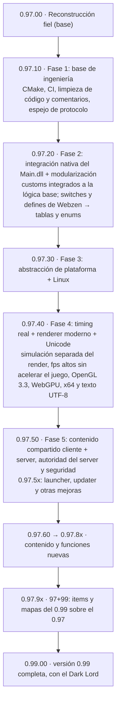
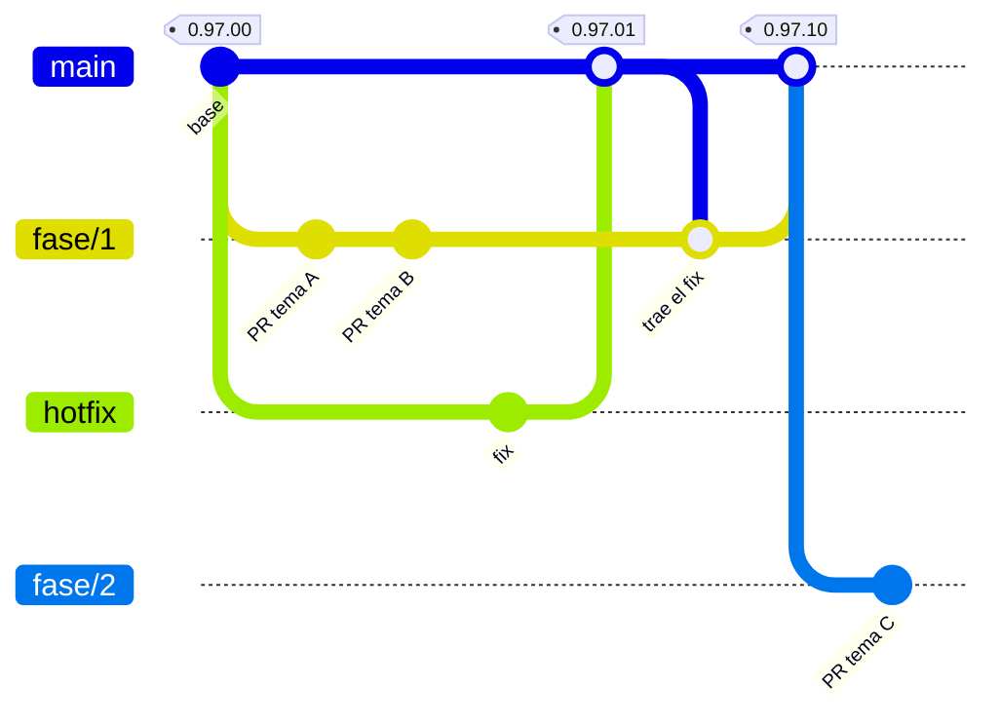

# Mu Online 0.97k — reconstrucción del código fuente

[](https://mu-linux.com/es/)

🇪🇸 Español | [🇺🇸 English](README.en.md) | [🇧🇷 Português](README.pt-BR.md)

Port a C++ del cliente **Mu Online 0.97k** (`main.exe`, MD5
`eb95ac0785e40a7ad60c9ddb5d8bef34`), reconstruido por ingeniería inversa a
partir del binario original.

El cliente compilado **se comporta igual que el binario original**: mismo flujo
de login, mismo render, mismos paquetes. No es una reescritura ni un "cliente
inspirado en": cada función es un port de su contraparte en el binario, y las
desviaciones deliberadas están documentadas en un comentario junto al código.

Sobre esa base se integraron las funciones del `Main.dll` de inyección (Fase 2),
se agregó soporte para Linux (Fase 3) y se pasó a 64 bits, con timing real,
renderer moderno y texto Unicode (Fase 4).

---

## Estado

**La reconstrucción está completa.** No quedan funciones del binario sin portar.
Puede quedar algún bug latente, que aparece al ejercitar un camino poco usado y
se corrige comparando contra IDA, pero la base de la ingeniería inversa está
terminada (tag `0.97.00`).

El cliente arranca, conecta, hace login, elige personaje, entra al mundo y se
juega: terreno, personajes, NPCs y monstruos, inventario, equipo, tienda, baúl,
trade, chat, party, guild, combate, skills, efectos, eventos, sonido y música.

| Plataforma | Render | Estado |
|---|---|---|
| Windows x64 | OpenGL 3.3 y WebGPU (DirectX 12, DirectX 11, Vulkan) | Completo; es el build publicado |
| Linux x64 | OpenGL 3.3 y WebGPU (Vulkan) | Completo; es el build publicado |
| Windows x86, Linux x86 | OpenGL 3.3 | Base histórica: compila, pero no se prueba ni recibe WebGPU |

### Novedades de 0.97.40 — cierre de la Fase 4

- **64 bits.** El cliente se compila y se publica en x64. Los layouts de 32 bits
  del binario original (entidades, modelos, pools, punteros guardados en
  enteros) se migraron a sus tamaños nativos. x86 queda como base histórica.
- **Timing real.** La simulación corre a 25 pasos por segundo, como el
  original, y el dibujo va aparte: más FPS no aceleran el juego. Límite de FPS
  y VSync configurables.
- **Renderer moderno.** OpenGL 3.3 core con shaders, en lugar del pipeline fijo
  del 0.97k, y un segundo backend WebGPU (Dawn) sobre DirectX 12, DirectX 11 o
  Vulkan. Ver [Render](#render).
- **Opciones gráficas nuevas**, todas apagadas por defecto: calidad de
  texturas, nitidez, antialiasing (FXAA y MSAA 4x), sombras proyectadas,
  niebla por profundidad, distancia de dibujado con la cámara 3D y un pack
  opcional de texturas HD.
- **Texto Unicode.** El cliente escribe, dibuja y manda UTF-8: nombres de
  personaje y guild en cualquier escritura, emojis en color, chat de hasta 200
  bytes y fuentes de respaldo para chino, japonés, coreano, árabe, hebreo,
  tailandés y devanagari. Ver [Textos, idiomas y Unicode](#textos-idiomas-y-unicode).
- **Textos que manda el server.** Nombres de items, monstruos y skills, líneas de
  tooltip de los items custom y los textos propios del cliente llegan
  traducidos al idioma del jugador desde el server.
- **Interfaz.** Panel de eventos (tecla H) paginado, barra de buffs con tiempo
  restante y quién lo lanzó, chat con historial de los últimos mensajes,
  selector de emojis, pantallas anchas hasta 3440x1440 con la interfaz anclada
  a los bordes, niebla con distancias por mapa definidas en el server.
- **Linux x64** con WebGPU sobre Vulkan, en X11 y Wayland.

**Compatibilidad: cliente 0.97.40 ↔ [server 0.97.40](https://github.com/EmanuelCatania/Mu-Linux-0.97k).**
El protocolo cambió (nombres de 40 bytes y chat de 200), así que cliente y
server tienen que actualizarse juntos: un cliente anterior ya no entra a un
server 0.97.40 y al revés.

---

## Qué necesitás

- **Los assets ya están incluidos** en `bin/Client/Data/` (~209 MB: modelos
  `.bmd`, texturas `.ozj`/`.ozt`, mapas, sonidos, música y las fuentes de
  respaldo). Clonás, compilás y arranca.
- **Una placa de video con OpenGL 3.3**, con el controlador instalado. Para WebGPU hace falta además DirectX 12,
  DirectX 11 o Vulkan; si no se puede crear el dispositivo, el cliente sigue con
  OpenGL.
- **Un servidor 0.97.40.** El port está validado contra
  [MuEmu - Linux](https://github.com/EmanuelCatania/Mu-Linux-0.97k) (season
  0.97k), que es la fuente autoritativa para el formato de los paquetes. Cada
  Release del cliente indica con qué versión del server funciona. Los servers
  0.97k sin los cambios de 0.97.40 (por ejemplo,
  [MuEmu - Kayito](https://github.com/nicomuratona/MuEmu-0.97k-kayito)) usan
  nombres de 10 bytes y no son compatibles con este cliente.

---

## Compilar

El cliente usa **SDL3** para ventana, entrada, sonido y red, y FreeType,
HarfBuzz y SheenBidi para el texto. Todo se descarga al configurar, en
versiones fijas, así que la primera configuración necesita internet.

Los builds publicados son **x64**. El backend `Win32` (la ventana y el texto
GDI del binario original) y los builds de 32 bits quedan como base histórica:
compilan, pero no tienen CI ni se prueban.

### Windows x64

Requiere **Visual Studio 2022** con el toolset de C++ para escritorio (trae
CMake) y [vcpkg](https://github.com/microsoft/vcpkg) para Dawn, el backend
WebGPU. La variable de entorno `VCPKG_ROOT` tiene que apuntar a una copia de
vcpkg (sirve la que trae Visual Studio o un `git clone` propio):

```
cmake --preset windows-sdl3-x64-release
cmake --build --preset windows-sdl3-x64-release
```

La primera configuración tarda: vcpkg compila Dawn y después lo deja en su
caché. Todo se enlaza estático, con el runtime de C++ estático (`/MT`), así que
el exe no trae DLL propias ni necesita el redistributable de Visual C++. La
versión de Dawn la fija el baseline de `vcpkg-configuration.json`; para pasar a
lo más nuevo: `vcpkg x-update-baseline`. El triplet propio está en
`cmake/triplets/`.

Salida: `bin/Client/main.exe` (más `main.map` para resolver stacks de crash).
El proyecto enlaza directo sobre `bin/Client/`, que es donde viven los assets y
`Config.ini`, así que no hay copia intermedia ni riesgo de terminar ejecutando
un binario viejo.

### Linux x64

Hace falta Git, CMake 3.25+, Ninja, Python 3, pkg-config, GCC/G++ y vcpkg (con
`VCPKG_ROOT` apuntando a su carpeta), más las bibliotecas de desarrollo del
escritorio:

- **Debian/Ubuntu:** `build-essential cmake ninja-build git python3 pkg-config
  libx11-dev libx11-xcb-dev libxext-dev libxrandr-dev libxinerama-dev
  libxcursor-dev libxi-dev libgl1-mesa-dev libegl-dev libasound2-dev
  libpulse-dev libwayland-dev libxkbcommon-dev libdecor-0-dev wayland-protocols
  libvulkan-dev`. Ubuntu 22.04 trae CMake 3.22: instalá CMake 3.25+ antes de
  configurar. En otras distribuciones, los paquetes equivalentes.

```sh
cmake --preset linux-x64-release
cmake --build --preset linux-x64-release
```

El ejecutable queda en `build/linux-x64-release/bin/main` (no en `bin/Client/`,
así no se mezcla con el de Windows). Para correrlo contra los assets del repo,
apuntá `MU_ASSET_ROOT` a `bin/Client` (ver [Correr en Linux](#correr-en-linux)).

### Builds históricos (x86 y Win32)

Siguen disponibles para comparar contra el binario original, que es de 32 bits.
Usan sólo OpenGL:

- **Windows x86:** `cmake --preset windows-sdl3-x86-release` y
  `cmake --build --preset windows-sdl3-x86-release`. También sale en
  `bin/Client/main.exe`, así que pisa al de x64.
- **Linux x86:** presets `linux-x86-release` y `linux-x86-debug`, con las
  bibliotecas de 32 bits y `PKG_CONFIG_LIBDIR` apuntando a ellas (por ejemplo,
  `/usr/lib32/pkgconfig:/usr/share/pkgconfig` en Arch).
- **Backend Win32:** `cmake -S . -B build -A Win32 -T v143 -DMU_PLATFORM_BACKEND=Win32`
  o `mu97k.sln` en
  Visual Studio. Su texto es GDI y sólo cubre Windows-1252.

### Para colaborar

- Mientras convivan el `.sln` y CMake, un `.cpp` nuevo se agrega en el
  `.vcxproj` **y** en el `CMakeLists.txt`. El CI falla si las dos listas no
  coinciden; se puede chequear local con
  `python .github/scripts/check_cmake_sources.py`.
- Dependencias incluidas en el repo: `lib/stb` (texturas `.ozj`/`.ozt` y
  capturas), `lib/miniaudio` (música), `lib/utf8proc`
  (normalización Unicode) y `lib/libunibreak` (dónde se puede cortar una línea).
  SDL3, FreeType, HarfBuzz y SheenBidi se descargan al configurar; Dawn, con
  vcpkg.
- El CI compila Windows x64 con WebGPU, Linux x64 con WebGPU y las bases SDL3
  históricas, corre las pruebas unitarias y arma los paquetes Linux.

---

## Configurar y jugar

### Apuntar a tu server

La dirección y la identidad del server van **compiladas en el cliente**, como en
MU 5.2: no hay archivo de configuración que distribuir. Están en
`src/Config/ServerConfig.h` y apuntan al server de referencia del proyecto; para
usar el tuyo, editá ese archivo y recompilá.

La dirección puede ser una IP o un nombre de host (el cliente lo resuelve por
DNS, igual que el original). Conviene un nombre: así no queda una IP pública
fija en el código y el server puede mudarse sin recompilar. Si el dominio está en
Cloudflare, el registro tiene que ir **sin proxy** ("DNS only"): el proxy sólo
deja pasar tráfico web y corta las conexiones del juego.

```cpp
constexpr char           ConnectServerIP[]   = "mu.server-pups.space";
constexpr unsigned short ConnectServerPort   = 44405;   // 0 = sin ConnectServer
constexpr char           GameServerIP[]      = "mu.server-pups.space";
constexpr unsigned short GameServerPort      = 55901;
constexpr char           CustomerName[]      = "MuLinux";
constexpr char           ServerSerial[]      = "TbYehR2hFUPBKgZj";
constexpr char           ClientVersion[]     = "0.97.40";
```

**Direcciones.** Con `ConnectServerPort` distinto de 0 se usa el flujo
ConnectServer: el cliente pide la lista real (`F4/02`), el server contesta con
nombres y ocupación, y al elegir uno el `F4/03` redirige al GameServer; si el
ConnectServer no responde, se conecta al GameServer. Con `0` se conecta directo
al GameServer y el select-server muestra una entrada fija.

> El select-server aparece **siempre**, incluso apuntando directo al GameServer:
> es una pantalla del flujo original, no un indicio de que estés llegando al
> ConnectServer.

**Identidad del server.** Los tres valores tienen que coincidir con los del
GameServer (`MuServer/GameServer/DATA/GameServerInfo - StartUp.dat`). Si alguno
no coincide, el cliente **conecta pero no entra**, y sin ningún mensaje útil:

| Valor | De dónde sale | Qué pasa si no coincide |
|---|---|---|
| `CustomerName` | `CustomerName=` del `.dat` | El cliente conecta, desencripta basura y se queda en *"conectando al GameServer"* para siempre |
| `ServerSerial` | `ServerSerial=` del `.dat` | Igual que arriba, **y además** el login devuelve *"versión incorrecta"* |
| `ClientVersion` | `ServerVersion=` del `.dat` | Login rechazado con *"versión incorrecta"* |

`CustomerName` y `ServerSerial` alimentan la clave de encriptación, que el
GameServer deriva de los dos combinados (`GameServer/HackCheck.cpp::InitHackCheck`).
`ServerSerial` cumple doble función: entra en esa derivación y además el server
lo compara byte a byte en el login. `ClientVersion` acepta `0.97.40` o `09740`.

**Para diagnosticar**, `debug.log` registra al arrancar la dirección usada y la
clave derivada:

```
ServerConfig: ConnectServer=mu.server-pups.space:44405 GameServer=mu.server-pups.space:55901 version='09740'
MuEmu: InitKeys CustomerName='MuLinux' Serial='TbYehR2hFUPBKgZj' -> EncDecKey1=0xC2 EncDecKey2=0x01 (xor=0xC2 add=0xC2)
```

Si el cliente se queda colgado conectando, esa línea es lo primero que hay que
mirar: comparala con el `CustomerName` del server.

### Opciones del jugador

Las preferencias se leen de **`Config.ini`**, con las mismas secciones y claves
que usaba el `Main.dll` de inyección, así sirve el `Config.ini` que ya tengas.
En Windows está en `bin/Client/Config.ini`; en Linux, en
`~/.local/share/mu97k/Config.ini`. La mayoría también se cambia desde el menú de
opciones del juego, que las guarda en el mismo archivo.

En Windows, si una clave no está en `Config.ini` manda el registro (donde el
0.97k original guardaba lo que configuraba el launcher oficial) y, si tampoco
está ahí, el default del binario. Lo que se aplicó queda en `debug.log` (línea
`Config.ini: ...`).

| Clave | Default | Notas |
|---|---|---|
| `[Window] WindowMode` | — (desviación) | `1` = en ventana, `0` = pantalla completa. El 0.97k sólo corre fullscreen y busca un modo de video de 16 bits que en Windows 10/11 no existe. |
| `[Window] Borderless` | — (desviación) | `1` = sin barra de título ni borde. Sólo aplica en modo ventana. |
| `[Window] Resolution` | `0` (640x480) | Índices del DLL: `0` 640x480, `1` 800x600, `2` 1024x768, `3` 1280x1024, `4` 1280x720, `5` 1366x768, `6` 1600x900, `7` 1920x1080, y `8` 3440x1440 (desviación). Ojo: el `4` no es el mismo del registro (ahí es 1600x1200). En pantallas anchas la interfaz y los avisos se anclan a los bordes. |
| `[Window] RenderBackend` | `opengl` | Backend de render; ver [Render](#render), donde también están las opciones gráficas (`TextureQuality`, `Sharpness`, `Antialiasing`, `Shadows`, `DepthFog`, `DrawDistance`, `HDTextures`). |
| `[Window] RenderDecoupled` | `1` | Desacopla el render; `0` vuelve al límite de 40 ms. La simulación sigue a 25 Hz. |
| `[Window] FpsLimit` | `60` | Límite de FPS con desacople activo; `0` = sin límite. Opciones → Pantalla permite 25/30/60/120/144/sin límite. |
| `[Window] VSync` | `0` | Sincronización vertical. Desacople, VSync y FPS se aplican en caliente y se guardan desde Opciones → Pantalla. VSync también limita «sin límite» al refresco de la pantalla. F12 muestra u oculta los FPS a la izquierda dentro del juego, incluso en pantalla completa; comienza oculto. |
| `[Sound] EnableSound` | `1` | Efectos de sonido. |
| `[Sound] EnableMusic` | `0` (apagada) | El `Config.ini` del repo la trae en `1`. El tema del login es `Data\Music\MuTheme.mp3`, que el pack no trae (como en el original). |
| `[Sound] SoundLevel`, `MusicLevel` | — (desviación) | Volumen de `0` (mudo) a `9` (volumen original); como en el DLL, cada nivel son 6,25 dB. |
| `[User] Username` | — | Precarga el campo de usuario del login. |
| `[Language] LangSelection` | — (`Text.bmd`, que acá es la variante en español) | Idioma de la interfaz: `Eng`, `Spn` o `Por`. Elige entre los `Text_*.bmd` y `Dialog_*.bmd` de `Data/Local/` y es el idioma que el cliente le pide al server para los nombres de items, monstruos y skills; ver [Textos, idiomas y Unicode](#textos-idiomas-y-unicode). |
| `[MiniMap] Alpha`, `ZoomLevel` | `10`, `0` | Transparencia (`3` a `10`) y zoom (`0` a `6`) del minimapa. |
| `[Antilag] Delete…` | `0` | Apagan partes del render para equipos lentos: `DeleteShadows`, `DeleteObjects`, `DeleteFloor`, `DeleteSkills`, `DeleteStaticEffects`, `DeleteDynamicEffects`, `DeleteWings`, `DeleteHealthBar`, `DeleteInterface`, `DeleteWeather`, `DeleteGlow`. |
| `[Font] FontName`, `FontHeight`, `FontBold`, `FontItalic`, `FontCharset`, `FontWidth`, `FontUnderline`, `FontQuality`, `FontStrikeOut` | Arial, alto según la resolución | Como el DLL: alto fijo (tope 25) y la fuente grande al doble. El `Config.ini` del repo trae Verdana 13. Si se borra la sección `[Font]` completa, el cliente vuelve a la fuente original. |
| `[Font] TextShadow`, `TextOutline`, `ColorEmoji` | `0`, `0`, `1` | Sombra y contorno del texto, y emojis en color (desviaciones). También en Opciones → Fuente. |

### Atajos que no son del original

| Tecla | Qué hace |
|---|---|
| **F10** / **F11** | Activa la cámara 3D / la vuelve a la normal |
| **F12** | Muestra u oculta los FPS |
| **H** | Panel de eventos |
| **Ctrl+V** | Pega en el campo de texto |

### Correr en Windows

Ejecutar `bin/Client/main.exe`.

### Correr en Linux

Cada Release trae el paquete Linux x64 (en el CI, artefacto
`mu97k-linux-x64-release`): el `.tar.gz`, su SHA256 y el inventario de
bibliotecas. Trae `main`, `Data`, licencias, README y `launch.sh`; no lleva el
`Config.ini` del desarrollador.

El ejecutable es **ELF64 x86-64**, compilado sobre Ubuntu 24.04 (no usa símbolos
de glibc posteriores a 2.39). SDL3, FreeType, HarfBuzz, SheenBidi, miniaudio y
Dawn van enlazados estáticamente; OpenGL, Vulkan, glibc y las bibliotecas del
escritorio (X11, Wayland, ALSA/PulseAudio) son del sistema. En un escritorio con
el driver de video instalado normalmente ya están; si falta alguna,
`ldd ./main` la muestra. Para WebGPU hace falta el loader de Vulkan
(`libvulkan1` en Debian/Ubuntu, `vulkan-icd-loader` en Arch) y el driver Vulkan
de la placa.

Descomprimí el `.tar.gz` en una partición Linux (en NTFS se pierden los permisos
de ejecución) y ejecutá `./launch.sh` desde una terminal, sin sudo. La
configuración, las capturas y el `debug.log` se guardan en
`${XDG_DATA_HOME:-$HOME/.local/share}/mu97k`; `MU_CLIENT_ROOT` permite elegir
otro directorio. El primer arranque crea una configuración en ventana a
1024×768 y nunca pisa preferencias existentes.

Para leer los assets desde otra carpeta sin copiarlos (por ejemplo, un disco
NTFS o el `bin/Client` del repo), apuntá `MU_ASSET_ROOT` a la carpeta **que
contiene `Data`**:

```sh
MU_ASSET_ROOT='/run/media/usuario/HDD/ruta/Client' ./launch.sh
```

Sin `SDL_VIDEODRIVER`, una sesión Wayland prueba Wayland y después
X11/XWayland; el backend elegido y el renderer quedan en stderr y en
`debug.log` al arrancar. Para forzar uno: `SDL_VIDEODRIVER=x11 ./launch.sh` o
`SDL_VIDEODRIVER=wayland ./launch.sh`. WebGPU funciona en los dos.

Otros detalles de Linux:

- `libdecor` da las decoraciones de ventana del lado del cliente. Sin él, un
  compositor que no decora del lado del server puede mostrar la ventana sin
  marco.
- En HiDPI se conserva la resolución lógica del juego y el compositor escala la
  imagen, que puede verse menos nítida.
- Los emojis en color salen de Noto Color Emoji, si está instalada (paquete
  `noto-fonts-emoji` en Arch, `fonts-noto-color-emoji` en Debian/Ubuntu).
- La captura de pantalla es con **Impr Pant**. En KDE la toma Spectacle antes
  de que llegue al juego.

### Build x86 en Linux: Wayland y GPUs NVIDIA

Esto afecta sólo al build histórico de 32 bits. Con NVIDIA tiene dos
consecuencias en Wayland nativo (encontradas en Arch, KDE Plasma, RTX 3080 Ti,
driver 615):

- **Sin la plataforma EGL Wayland de 32 bits, Wayland usa render por software.**
  NVIDIA sólo distribuye `egl-wayland` para x64. Sin
  `libnvidia-egl-wayland.so.1` en `/usr/lib32`, el contexto GL de Wayland cae en
  Mesa `llvmpipe`. El cliente lo detecta al arrancar (`Renderer por software en
  wayland`) y pasa solo a X11/XWayland, donde GLX sí usa la GPU.
- **Con esa plataforma instalada, Wayland nativo funciona pero rinde mucho
  menos**: el driver EGL de NVIDIA en 32 bits resuelve variables thread-local en
  cada llamada GL. Con NVIDIA, corré el build x86 en X11
  (`SDL_VIDEODRIVER=x11 ./launch.sh`).

---

## Render

El 0.97k dibuja con el pipeline fijo de OpenGL 1.x, vértice por vértice. El
cliente conserva lo que se ve (los mismos modelos, texturas, mezclas y efectos),
pero lo manda a la placa por buffers y shaders. Hay dos backends, que se eligen
en **Opciones → Pantalla → Avanzado → Gráficos** (`[Window] RenderBackend` en
`Config.ini`) y se aplican al reiniciar:

| Backend | Clave | Qué usa |
|---|---|---|
| OpenGL | `opengl` (default) | Contexto OpenGL 3.3 core. Disponible en todos los builds. |
| WebGPU | `auto` | [Dawn](https://dawn.googlesource.com/dawn) elige: en Windows prefiere Vulkan, y si no hay, DirectX 12 o 11; en Linux, Vulkan. |
| DirectX 12 / DirectX 11 / Vulkan | `d3d12` / `d3d11` / `vulkan` | WebGPU forzado sobre esa API. DirectX sólo en Windows. |

WebGPU sólo existe en los builds x64. Si el dispositivo no se puede crear, el
cliente sigue con OpenGL. Con WebGPU los modelos quedan residentes en la placa y
el skinning (deformar la malla con los huesos) lo hace la GPU.

El backend activo y la placa quedan en `debug.log` al arrancar (por ejemplo
`WebGPU: Vulkan | NVIDIA GeForce RTX 3080 Ti`).

> **NVIDIA y DirectX:** el driver de NVIDIA trae un perfil para los ejecutables
> llamados `main.exe` que limita DirectX 11 y 12 a 60 FPS. Vulkan no lo tiene;
> por eso `auto` lo prefiere en Windows.

### Opciones gráficas

Todas son desviaciones respecto del original y arrancan apagadas: con los
valores por defecto se ve como el 0.97k. Se cambian desde el mismo submenú, **Opciones
→ Pantalla → Avanzado → Gráficos**, y se guardan en `[Window]`.

| Clave | Valores | Qué hace |
|---|---|---|
| `TextureQuality` | `0` original, `1` mipmaps, `2` mipmaps + bicúbico | Texturas lejanas sin parpadeo. El paso a mipmaps se aplica al reiniciar. |
| `Sharpness` | `0` a `3` | Realce de bordes sobre la imagen 3D; `3` es el máximo de AMD CAS. |
| `Antialiasing` | `0` apagado, `1` FXAA, `2` MSAA 4x, `3` MSAA 4x + FXAA | MSAA se aplica al reiniciar. |
| `Shadows` | `0` sombra plana del original, `1` suaves, `2` fuertes | Sombras proyectadas con mapa de sombras. |
| `DepthFog` | `0` / `1` | Niebla por profundidad con la cámara 3D. |
| `DrawDistance` | `0` a `3` (×1, ×1,5, ×2, ×3) | Alcance de dibujado con la cámara 3D. Lejos sólo se dibuja el terreno. |
| `HDTextures` | `0` / `1` | Usa el pack de texturas HD de `Data/HD/` si está. No viene en el repo; se aplica al reiniciar. |

La **cámara 3D** (tecla **F10**, **F11** la vuelve a la normal) es la del DLL de
inyección. La distancia de dibujado y la niebla por profundidad sólo se aplican
con ella: la cámara normal ve lo mismo que el original. La niebla de cada mapa
la define el server (`MapFog.txt`); con la cámara 3D y `DepthFog=1` la
reemplaza la niebla por profundidad.

---

## Textos, idiomas y Unicode

El 0.97k guarda y dibuja el texto en Windows-1252: sólo alfabeto latino, y los
nombres de personaje tienen 10 bytes. Desde 0.97.40 **cliente y server usan
UTF-8 de punta a punta**.

### Qué se puede escribir

- **Nombres de personaje y guild** en cualquier escritura: hasta 10 caracteres
  el de personaje y 8 el de guild (cada uno cuenta como lo ve el jugador, aunque
  ocupe varios bytes). Se aceptan letras, marcas y dígitos; el server aplica la
  misma regla y los guarda normalizados (NFC). Las cuentas y contraseñas siguen
  siendo ASCII.
- **Chat, susurros, avisos de guild y `/post`** de hasta 200 bytes.
- **Entrada:** el teclado del sistema (con IME para chino, japonés o coreano) y
  **Ctrl+V** para pegar.
- **Emojis** en color, con la fuente del sistema (Segoe UI Emoji en Windows, Noto
  Color Emoji en Linux). Hay un selector junto al campo del chat, y los códigos
  `:D`, `<3` y `:fire:` se reemplazan por su emoji. Con `[Font] ColorEmoji=0`
  salen en blanco y negro.

### Cómo se dibuja

El texto pasa por HarfBuzz (forma de los caracteres, ligaduras), SheenBidi
(escrituras de derecha a izquierda, como árabe y hebreo) y libunibreak (dónde se
puede cortar una línea en chat, burbujas y diálogos). Lo que la fuente elegida
no tiene se busca, carácter por carácter, en las fuentes de respaldo de
`bin/Client/Data/Font/` (chino, japonés, coreano, árabe, hebreo, tailandés,
devanagari y emoji) y después en las del sistema. Se pueden agregar más `.ttf` u
`.otf` a esa carpeta; el detalle está en
[`Respaldo-README.md`](bin/Client/Data/Font/Respaldo-README.md).

`[Font]` en `Config.ini` elige la fuente principal, el tamaño, el suavizado
(`FontQuality`), una sombra (`TextShadow=1`) y un contorno (`TextOutline=1`);
también se cambia desde Opciones → Fuente.

### Idiomas y textos que manda el server

`[Language] LangSelection` (`Eng`, `Spn` o `Por`) elige dos cosas:

1. **Los textos del cliente**, como en el original: los `Text_*.bmd` y
   `Dialog_*.bmd` de `Data/Local/`.
2. **Los textos que pide al server.** Al conectarse, el cliente le dice su
   idioma, y el server le manda, junto con el catálogo de contenido, las
   traducciones de ese idioma:

| Archivo del server | Qué traduce |
|---|---|
| `Data/Text/<idioma>/Item.txt` | nombres de items |
| `Data/Text/<idioma>/Monster.txt` | nombres de monstruos y NPCs |
| `Data/Text/<idioma>/Skill.txt` | nombres de skills |
| `Data/Text/<idioma>/Tooltip.txt` | líneas del tooltip de los items custom |
| `Data/Text/<idioma>/Client.txt` | los textos propios del cliente (opciones, panel de eventos, barra de buffs, título de la ventana) |

Lo que no esté traducido sale de los `.bmd` del cliente (o, para `Client.txt`,
del inglés que trae compilado). Así un server puede traducir sus items custom, o
corregir una traducción, sin repartir un cliente nuevo. En `Client.txt`, los
`%d`/`%s` de cada línea tienen que ser los mismos que los del inglés y en el
mismo orden: si no, el cliente descarta la línea y usa la suya.

Los archivos se editan a mano (UTF-8 sin BOM) o desde el editor de traducciones
del panel web del server, que valida lo mismo que el cliente. El formato está
explicado en el encabezado de cada archivo.

---

## Cómo agregar items custom

Con el `Main.dll` de inyección, un item custom se agregaba de los dos lados: el
server lo definía en su `Item.txt`, y el cliente necesitaba un `item.bmd`
regenerado más los `.txt` del `Encoder` (`CustomItem.txt`, `CustomGlow.txt`,
etc.) empaquetados en `ClientInfo.bmd`. Si cliente y server no coincidían, el
item se veía mal o el server lo rechazaba.

Ahora **el server es la única fuente**. Al loguearse, le manda al cliente un
catálogo con todas las definiciones (items, monstruos, efectos, pets). El
cliente **sólo necesita los archivos del modelo** (`.bmd` y texturas) dentro de
`bin/Client/Data`. No hay que regenerar `item.bmd` ni tocar código.

Los `.txt` del `Encoder` del DLL se siguen leyendo desde
`Data/Custom/Encoder` del server, así que una carpeta de customs armada para el
DLL funciona sin convertir nada.

### Índices: el rango clásico y el extendido

Cada sección de items (espadas, hachas, …, joyas) tiene en el 0.97k **32
índices** (0 a 31). Además, cada sección acepta índices **32 a 511**: son los
items *agregados*. En el protocolo viajan con 13 bits (el item usa 7 bytes en
vez de 5), así que entran sin pisar ningún item vanilla.

Un agregado necesita decir **qué item vanilla imita** (columna *Comportamiento*):
eso decide la lógica que el 0.97k tiene escrita por tipo de item (si es un arco
y gasta flechas, si es un ala, si es una joya, qué opciones excellent puede
tener). Todo lo demás —nombre, stats, tamaño, modelo, brillo, efectos— sale de
su propia fila.

### Ejemplo 1: la Knight Blade, como se hacía con el DLL

El item está dentro del rango clásico (`0,20`); el modelo y el brillo se
definen en el `Encoder`:

```
// Data/Custom/Encoder/CustomItem.txt
00,020		22		"Sword21"		// Knight Blade

// Data/Custom/Encoder/CustomGlow.txt
00,020		191	165	127		// Knight Blade
```

Assets en el cliente: `bin/Client/Data/Item/Custom/20/` (`sword21.bmd` y sus
texturas).

### Ejemplo 2: la Crimson Knight Blade, fuera del rango clásico

El mismo modelo como item agregado (`0,32`), todo en una fila de
`Data/Item/Item.txt`. Al final de las columnas de siempre se agregan:
comportamiento, carpeta y nombre del modelo, y el color del brillo (RGB):

```
32	0	22	1	4	1	1	0	"Crimson Knight Blade"	...	00,020	"Item\Custom\20\"	"Sword21"	255	40	40
```

Se comporta como la Knight Blade (`00,020`), usa el modelo `Sword21` y brilla en
rojo. Comando de prueba: `/make 0 32`.

### Ejemplo 3: el set Great Dragon

Cinco piezas en el índice `21` de las secciones 7 a 11, con el modelo definido
en el `CustomItem.txt` del `Encoder` (como en el DLL):

```
07,021		0		"HelmMale22"		// Great Dragon Helm
08,021		0		"ArmorMale22"		// Great Dragon Armor
09,021		0		"PantMale22"		// Great Dragon Pant
10,021		0		"GloveMale22"		// Great Dragon Glove
11,021		0		"BootMale22"		// Great Dragon Boot
```

Assets en el cliente: `bin/Client/Data/Player/Custom/21/`. Las mismas piezas
también se pueden definir sin el `Encoder`, con las columnas de modelo en
`Item.txt` (`"Player\Custom\21\" "HelmMale22"`).

### Ejemplo 4: efectos propios y pose en el inventario

`Data/Custom/Items/<sección>_<índice>.json` agrega a un item (custom o vanilla)
su pose en el inventario y efectos que el cliente dibuja sobre los huesos del
modelo. Por ejemplo, unas alas con los destellos de las Wings of Illusion del
5.2:

```json
{
  "item": "12,032",
  "effects": [
    { "on": "equipped", "type": "sprite", "texture": "Effect/Flare.jpg",
      "bones": [5, 6, 7, 8, 18, 19], "color": [0.5, 0.0, 0.0], "scale": 0.6,
      "pulse": { "speed": 0.002, "scale": 0.2, "color": 0.4 } },
    { "on": "equipped", "type": "particle", "particle": 1230,
      "bones": [13, 31], "chance": 2, "color": [0.8, 0.8, 0.3], "scale": 0.5 }
  ]
}
```

En el repo del server hay un caso real: `Data/Custom/Items/03_000.json` corrige
la posición del Light Spear (vanilla) en su casilla, con la corrección del 5.2.

### Ejemplo 5: un pet custom (Pet Rudolph)

El Rudolph del 5.2 como pet que da vueltas alrededor del jugador y levanta el
zen cercano. Va en un índice alto (`13,400`) a propósito, para que sirva de
ejemplo del rango extendido. Son cuatro archivos, todos incluidos en los repos:

| Dónde | Archivo | Qué define |
|---|---|---|
| cliente | `bin/Client/Data/Item/Custom/Rudolph/` | el modelo `xmas_deer.bmd` y sus texturas |
| server | `Data/Item/Item.txt` | la fila del item: `Slot` 8 (helper), comportamiento `*` (no imita a ningún pet vanilla) y el modelo |
| server | `Data/Custom/Items/13_400.json` | la pose en el inventario |
| server | `Data/Custom/Pets/13_400.json` | cómo se mueve y qué hace |

```json
{
  "item": "13,400",
  "blendMesh": 0,
  "movement": { "type": "orbit", "radius": 50, "period": 4000, "height": 20 },
  "abilities": [ { "type": "pickup", "what": "zen", "range": 3, "interval": 1000, "delay": 1500 } ]
}
```

El cliente dibuja el movimiento; las habilidades (levantar el zen) las ejecuta
el server, que es el que decide. Comando de prueba: `/make 13 400`.

### Ejemplo 6: un monstruo custom (Karane)

Como en el DLL, con `Data/Custom/Encoder/CustomMonster.txt` (índice, tipo
`0`=NPC `1`=monstruo, dorado, escala, carpeta y modelo):

```
152		1		1		2.0		"Monster\\Karane\\"		"Karane"		// Karane
```

O directamente en `Data/Monster/Monster.txt`, con las mismas columnas al final
de la fila del monstruo:

```
152	0	"Karane"	...	0	0	1	1	2.0	"Monster\Karane\"	"Karane"
```

Assets en el cliente: `bin/Client/Data/Monster/Karane/`.

### Referencia

Columnas opcionales al final de cada fila de `Item.txt` (`*` = sin valor):

| Columna | Ejemplo | Qué hace |
|---|---|---|
| Comportamiento | `00,020` | vanilla que imita en la lógica |
| Carpeta y modelo | `"Item\Custom\20\" "Sword21"` | modelo en el inventario, el suelo y el personaje |
| Brillo | `255 40 40` | color del brillo por nivel |
| Carpeta y modelo puesto | `"Item\Custom\FenrirMount\" "fenril_black"` | sólo si el item se ve distinto puesto (una montura) |
| Gate | `22` | para pergaminos: lleva siempre a ese gate |

Los JSON de `Data/Custom/Items` también aceptan `"tooltip"`: hasta 6 líneas
propias debajo del nombre del item, como texto (`"Zen picker"`) o con color
(`{ "text": "Zen picker", "color": "gold" }`; colores: `white`, `blue`, `red`,
`gold`, `green`, `darkred`, `purple`, `darkblue`, `darkgold`).

Para alas custom, `Data/Item/CustomWing.txt` agrega las constantes de defensa y
daño. Los JSON de `Data/Custom/Items` y `Data/Custom/Pets` se validan al
arrancar el server: un archivo con errores se descarta entero y el motivo queda
en `GameServer/LOG`.

---

## Estructura

```
mu97k-src/
├── CMakeLists.txt       build del cliente (SDL3 en Windows y Linux, x64 y x86)
├── CMakePresets.json    presets de Windows y Linux
├── vcpkg.json           Dawn (WebGPU), sólo para los builds x64
├── mu97k.sln            solución de VS2022 (backend Win32 histórico)
├── mu97k.vcxproj        proyecto (Win32 histórico)
├── cmake/               módulos de CMake, toolchains y el triplet de vcpkg
├── tests/               pruebas unitarias que corre el CI
├── lib/stb/             decodifica las texturas .ozj/.ozt y guarda las capturas
├── lib/miniaudio/       reproduce la música
├── lib/utf8proc/        normalización Unicode
├── lib/libunibreak/     cortes de línea (UAX #14)
└── src/
    ├── WinMain.cpp      punto de entrada + loop de mensajes
    ├── Platform/        interfaces de plataforma y sus backends (SDL3/, Posix/, Win32/)
    ├── Render/Backend/  backends de render (OpenGL 3.3 y WebGPU)
    ├── Text/            texto UTF-8: medición, shaping, cortes y emojis
    ├── globals.{h,cpp}  estado global; los DAT identificados conservan trazabilidad IDA
    ├── functions.h      declaraciones compartidas y procedencia IDA de símbolos renombrados
    ├── structs.h        layouts de struct verificados contra IDA
    ├── ghidra_compat.h  macros que el decompile da por existentes (qmemcpy, LODWORD, ...)
    │
    ├── Combat/  Config/  Core/    Entity/  Game/     GameGuard/ Input/ Item/
    ├── Local/   Math/    Model/   Monster/ Net/       Party/     Path/  Physics/
    └── Render/  Scene/   Sound/   Terrain/ Text/      Trade/     UI/    Util/
```

Los módulos agrupan por responsabilidad. La dirección en el binario sigue
siendo una pista importante para verificar una función o resolver un símbolo,
pero no determina la ubicación del código portado.

---

## Hoja de ruta

Cada versión `XX.XX.00` equivale a una versión de Webzen: `0.97.00` es el 0.97k,
`0.99.00` será el 0.99 y así con cada Season. Los tags intermedios son el camino
hacia la versión siguiente.

### Línea 0.97

El tag `0.97.00` cierra la reconstrucción fiel: el cliente se comporta como el
binario original. Sobre esa base, la línea 0.97 se trabaja por fases de
ingeniería; cada fase cerrada es una versión.



Los números de cada fase son la versión prevista al cerrarla; el alcance de cada
una puede ajustarse en el camino.

### Después de la 0.97

Las fases de ingeniería son propias de la línea 0.97. Desde `0.99.00`, los tags
intermedios suman lo que trae cada versión de Webzen, siguiendo sus parches,
hasta completar la siguiente: la Season 1, después la Season 2 (que llega con la
Summoner), y así.

### Versionado

Las versiones son `XX.XX.YZ`, siempre de dos dígitos al final.

| Tag | Qué es |
|---|---|
| `0.97.00` | base de la reconstrucción fiel (equivale al 0.97k) |
| `0.97.01`, `0.97.02`… | correcciones sobre la base |
| `0.97.10` | cierre de la Fase 1 |
| `0.97.11`, `0.97.12`… | correcciones y mejoras sobre la Fase 1 |
| `0.97.20` … `0.97.50` | cierre de las fases siguientes, y así |
| `0.97.9x` | 97+99: contenido del 0.99 sobre el 0.97 |
| `0.99.00` | versión 0.99 completa |

En la línea 0.97, **Y** es la fase y **Z** el arreglo o la mejora. En las líneas
siguientes, los tags intermedios marcan el avance hacia la próxima versión de
Webzen.

El cliente y el [server](https://github.com/EmanuelCatania/Mu-Linux-0.97k) usan la
misma numeración, pero el server sólo recibe un tag nuevo cuando cambia. Cada
Release del cliente indica con qué tag del server funciona (por ejemplo, el
cliente `0.97.32` funciona con el server `0.97.30`).

### Ramas



- `main` sólo recibe cierres de fase y correcciones; cada merge lleva su tag y su
  Release.
- Cada fase se trabaja en `fase/N`. Las ramas de tema (`fix/…`, `feat/…`, `chore/…`)
  salen de `fase/N` y vuelven por PR.
- Una corrección sobre una versión publicada sale del tag afectado, se mergea a
  `main` con su nuevo tag y también a la fase en curso.

---

## Licencia

MIT — ver [LICENSE](LICENSE).

La licencia cubre **el código**: todo lo que está bajo `src/`.

**No** cubre los assets de `bin/Client/Data/`, que son copyright de WebZen Inc.

Las bibliotecas de terceros mantienen sus propias licencias: stb y miniaudio
(dominio público / MIT-0), utf8proc (MIT), libunibreak (zlib), SDL3 (zlib),
FreeType (FreeType License), HarfBuzz (MIT), SheenBidi (Apache 2.0) y Dawn
(BSD 3-Clause). Las fuentes de `bin/Client/Data/Font/` tienen la suya al lado
(SIL OFL 1.1 o Apache 2.0). El paquete Linux incluye las licencias en
`licenses/`.

---

## Apéndice: la reconstrucción

Esta parte es para quien quiera verificar un port contra el binario o seguir la
historia de la ingeniería inversa. No hace falta para compilar ni para jugar.

### El binario original

El `main.exe` original no está en el repo: sólo hace falta para decompilarlo y
comparar un port contra él. Sale de cualquier distribución del cliente 0.97k.
Verificá el MD5 (`eb95ac0785e40a7ad60c9ddb5d8bef34`) antes de comparar
direcciones: hay muchas variantes parcheadas dando vueltas y no coinciden.

### La regla principal: fiel al binario

El orden de autoridad para resolver cualquier duda:

1. **IDA / el binario original.** Es la verdad. Si el decompile dice algo raro,
   probablemente el decompile tenga razón y nuestra intuición no.
2. **El servidor MuEmu**, para todo lo que sea formato de paquetes.
3. **El DLL de inyección**, como segunda referencia de comportamiento.
4. **El source de Mu Online 5.2**, sólo como apoyo semántico y de nomenclatura
   cuando el contexto actual lo permite. No se copia implementación ni se
   incorpora comportamiento de 5.2: la UI, las definiciones y las features
   pueden diferir de 0.97k.

Lo que no está en ninguna de esas fuentes no se inventa. Si hace falta una
desviación (porque un camino del original es inalcanzable, o depende de algo
que todavía no está portado), se implementa **y se documenta en un comentario
ahí mismo**, explicando qué hace el original y por qué nos apartamos.

Lo único que se saltea deliberadamente es el ruido anti-tamper: las
operaciones de hash-table intercaladas, los bloques inalcanzables y el
scrambling XOR de la versión protegida. No son lógica de juego.

### Nombres y comentarios en el código

El código está en español. Los símbolos que ya pudieron identificarse se nombran
por responsabilidad; su definición canónica conserva un comentario
`// IDA: <nombre> (<dirección>)` para mantener la trazabilidad con el binario.

Los `FUN_*` y `DAT_*` que todavía aparecen en el código no son, por sí solos,
deuda de renombrado. Algunos describen infraestructura, CRT, GameGuard, layouts
binarios, pools o compatibilidad; otros requieren investigación antes de poder
recibir un nombre semántico seguro. Tampoco son deuda los aliases o bridges ABI
que quedan en `functions.h`/`globals.h`: mantienen el contrato original de los
ports que los usan.

Los comentarios describen **el código actual**: la referencia a IDA, el layout
de un struct o paquete, las desviaciones vigentes respecto del binario y las
advertencias que evitan romper algo. La historia de cómo se llegó a un fix
(fechas, sondas, intentos descartados, lo que hacía el port viejo) va en el
mensaje del commit. Los comentarios de desarrollo que estaban en el código y los
decompilados de IDA que nunca se activaron (antes en `src/stubs_IDA_ports.cpp`)
quedaron archivados en `docs/` del tag `0.97.21`; el texto original completo
sigue en el tag `0.97.00`.

### Trampas conocidas

Estas costaron sesiones enteras de depuración. Todas volvieron a aparecer más de
una vez.

**1. Símbolos duplicados.** El mismo nombre definido dos veces: un stub viejo y
el port real. C++ puede aceptarlo como sobrecarga si las firmas difieren, y
entonces cada llamador resuelve a una copia distinta. Síntoma típico: un valor
se corrompe y no aparece ningún escritor que lo explique. Antes de auditar
cualquier función, confirmá que estás leyendo **la copia que se compila** —
no una dentro de `#if 0`. Corolario: una sonda de diagnóstico puesta en código
muerto da cero resultados, y ese silencio parece evidencia de que no hay bug.

**2. Locales que Ghidra separó.** El decompile emite como variables sueltas lo
que en el frame original era un bloque contiguo, y el código las recorre como
si lo fueran (`&local_XX` de un escalar pasado como `vec3`). El compilador no
garantiza ese layout. Síntoma: la primera componente sale bien y el resto es
basura (valores de ~1e9). Se arregla reconstruyendo el frame como un array
contiguo y mapeando los nombres por offset.

**3. Campos enteros leídos como float.** Ghidra tipa el slot como `float*` y
entonces *todo* acceso sale como float, incluidos los campos que son enteros o
punteros. `(float)(uintptr_t)ptr` convierte numéricamente lo que había que
reinterpretar por bits. Síntoma: no es un crash, es funcionalidad que
simplemente no ocurre — comparaciones que nunca dan verdadero, punteros en
cero, contadores clavados. Pista: valores de ~1e9 que leídos como bits dan
floats chicos y razonables. Dentro de un mismo archivo suelen convivir accesos
correctos y rotos; esa mezcla es la señal.

**4. Padding de structs en los paquetes.** El servidor manda structs de C con
su padding de alineación. Leer los campos por offset "lógico" en vez del real
devuelve basura convincente. Ya mordió en los stats, en la lista de guild y en
los números de daño.

**5. Las etiquetas de los offsets mienten.** Varios campos de la struct de
entidad estuvieron mal etiquetados durante meses (`+0x1BC` no son flags de
movimiento: es la clase del personaje; `+0x34E` no es "muerto": es SafeZone).
Antes de confiar en el nombre de un offset, buscá quién lo **escribe** en el
binario.

**6. Nombres de funciones parecidos con efectos opuestos.** El caso recurrente
es la familia de estado de OpenGL: `EnableAlphaTest` (0x511680),
`EnableAlphaBlend` (0x511710, aditivo) y `DisableTexture` (0x511590, que apaga
el texturizado). Confundirlas pinta cuadrados blancos sobre medio frame,
porque el estado de GL queda pegado y contamina todo lo que se dibuje después.

**7. Cotas y limpiezas inventadas.** Guards que el binario no tiene y que en vez
de recortar **descartan la entrada entera**. Apareció de los dos lados: en los
handlers de red (`count > 30` tiraba los 41 monstruos de un viewport; el síntoma
se leía como bug de spawn, con una cascada de `key not found` en el log) y en el
input tick (un `else` que al bloquear el debounce hacía
`MouseLButtonPush = 0; MouseLButton = 0;`, o sea perdía el click: había que
clickear varias veces para caminar). Regla: cualquier `= 0` o `clear` que el port
agregue en el camino de *«todavía no se puede»* es sospechoso — el binario casi
siempre deja el estado pendiente para el próximo tick.

### Desviaciones de protocolo

Están documentadas en el código, pero conviene saberlas si se apunta a otro
servidor:

- **`C3:1E` (duration skill) se manda con 11 bytes, no 9.** El 0.97k vanilla no
  incluye `index[]`, pero `CGDurationSkillAttackRecv` de MuEmu lo lee siempre
  (`SkillManager.cpp:2047`): con 9 bytes el server toma esos dos bytes de fuera
  del paquete y el skill le pega a otra entidad. El DLL de inyección hace lo
  mismo (`CPatchs::SendRequestMagicContinue`).
- **Triple Shot manda el byte `angle`.** El server arma el cono con `angle`, no
  con `dir` (`SkillManager.cpp:1185`).
- **Texto en UTF-8 (0.97.40).** Nombres de personaje de 40 bytes, de guild de
  32 y chat de 200, en lugar de los 10 bytes en Windows-1252 del 0.97k. Los
  paquetes que con esos largos pasan de 255 bytes (lista de personajes, party,
  ranking de Devil Square) viajan con header C2. Un server sin estos cambios no
  es compatible.
- **F3/12 al entrar al mundo.** Sin ese ACK el server deja `RegenOk` en 1 y
  rechaza todo `/move` posterior además de no mandar las entidades del mapa.
