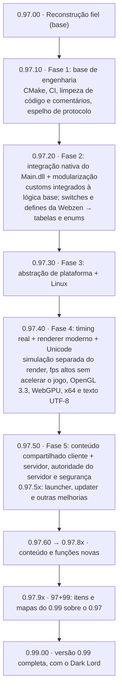
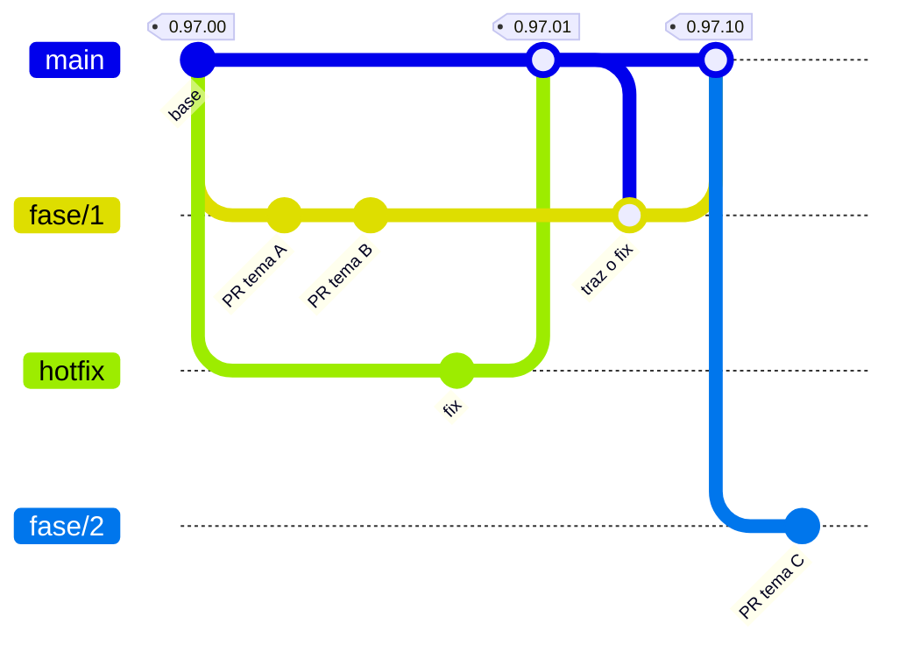

# Mu Online 0.97k — reconstrução do código-fonte

[](https://mu-linux.com/es/)

[🇪🇸 Español](README.md) | [🇺🇸 English](README.en.md) | 🇧🇷 Português

Port em C++ do cliente **Mu Online 0.97k** (`main.exe`, MD5
`eb95ac0785e40a7ad60c9ddb5d8bef34`), reconstruído por engenharia reversa a
partir do binário original.

O cliente compilado **se comporta igual ao binário original**: mesmo fluxo de
login, mesmo render, mesmos pacotes. Não é uma reescrita nem um "cliente
inspirado em": cada função é um port da sua contraparte no binário, e os desvios
deliberados estão documentados em um comentário ao lado do código.

Sobre essa base foram integradas as funções do `Main.dll` de injeção (Fase 2),
foi adicionado suporte a Linux (Fase 3) e o cliente passou a 64 bits, com timing
real, renderer moderno e texto Unicode (Fase 4).

---

## Estado

**A reconstrução está completa.** Não restam funções do binário sem portar.
Ainda pode aparecer algum bug latente ao exercitar um caminho pouco usado, que
se corrige comparando com o IDA, mas a base da engenharia reversa está
terminada (tag `0.97.00`).

O cliente inicia, conecta, faz login, escolhe personagem, entra no mundo e se
joga: terreno, personagens, NPCs e monstros, inventário, equipamento, loja,
baú, trade, chat, party, guild, combate, skills, efeitos, eventos, som e música.

| Plataforma | Render | Estado |
|---|---|---|
| Windows x64 | OpenGL 3.3 e WebGPU (DirectX 12, DirectX 11, Vulkan) | Completo; é o build publicado |
| Linux x64 | OpenGL 3.3 e WebGPU (Vulkan) | Completo; é o build publicado |
| Windows x86, Linux x86 | OpenGL 3.3 | Base histórica: compila, mas não é testada nem recebe WebGPU |

### Novidades da 0.97.40 — fechamento da Fase 4

- **64 bits.** O cliente é compilado e publicado em x64. Os layouts de 32 bits
  do binário original (entidades, modelos, pools, ponteiros guardados em
  inteiros) foram migrados para seus tamanhos nativos. O x86 fica como base
  histórica.
- **Timing real.** A simulação roda a 25 passos por segundo, como no original,
  e o desenho é separado: mais FPS não aceleram o jogo. Limite de FPS e VSync
  configuráveis.
- **Renderer moderno.** OpenGL 3.3 core com shaders, no lugar do pipeline fixo
  do 0.97k, e um segundo backend WebGPU (Dawn) sobre DirectX 12, DirectX 11 ou
  Vulkan. Veja [Render](#render).
- **Novas opções gráficas**, todas desligadas por padrão: qualidade de
  texturas, nitidez, antialiasing (FXAA e MSAA 4x), sombras projetadas, névoa
  por profundidade, distância de desenho com a câmera 3D e um pacote opcional
  de texturas HD.
- **Texto Unicode.** O cliente digita, desenha e envia UTF-8: nomes de
  personagem e guild em qualquer escrita, emojis coloridos, chat de até 200
  bytes e fontes de reserva para chinês, japonês, coreano, árabe, hebraico,
  tailandês e devanágari. Veja [Textos, idiomas e Unicode](#textos-idiomas-e-unicode).
- **Textos enviados pelo servidor.** Nomes de itens, monstros e skills, as
  linhas de tooltip dos itens custom e os textos próprios do cliente chegam do
  servidor traduzidos para o idioma do jogador.
- **Interface.** Painel de eventos (tecla H) paginado, barra de buffs com tempo
  restante e quem lançou, chat com histórico das últimas mensagens, seletor de
  emojis, telas largas até 3440x1440 com a interface ancorada às bordas, névoa
  com distâncias por mapa definidas no servidor.
- **Linux x64** com WebGPU sobre Vulkan, em X11 e Wayland.

**Compatibilidade: cliente 0.97.40 ↔ [servidor 0.97.40](https://github.com/EmanuelCatania/Mu-Linux-0.97k).**
O protocolo mudou (nomes de 40 bytes e chat de 200), então cliente e servidor
precisam ser atualizados juntos: um cliente anterior não entra mais num
servidor 0.97.40, e vice-versa.

---

## O que você precisa

- **Os assets já estão incluídos** em `bin/Client/Data/` (~209 MB: modelos
  `.bmd`, texturas `.ozj`/`.ozt`, mapas, sons, música e as fontes de reserva).
  Clone, compile e ele roda.
- **Uma placa de vídeo com OpenGL 3.3**, com o driver instalado. O WebGPU
  precisa também de DirectX 12, DirectX 11 ou Vulkan; se o dispositivo não
  puder ser criado, o cliente segue com OpenGL.
- **Um servidor 0.97.40.** O port é validado contra
  [MuEmu - Linux](https://github.com/EmanuelCatania/Mu-Linux-0.97k) (season
  0.97k), que é a fonte autoritativa para o formato dos pacotes. Cada Release do
  cliente indica com qual versão do servidor funciona. Servidores 0.97k sem as
  mudanças da 0.97.40 (por exemplo,
  [MuEmu - Kayito](https://github.com/nicomuratona/MuEmu-0.97k-kayito)) usam
  nomes de 10 bytes e não são compatíveis com este cliente.

---

## Compilar

O cliente usa **SDL3** para janela, entrada, som e rede, e FreeType, HarfBuzz e
SheenBidi para o texto. Tudo é baixado ao configurar, em versões fixas, então a
primeira configuração precisa de internet.

Os builds publicados são **x64**. O backend `Win32` (a janela e o texto GDI do
binário original) e os builds de 32 bits ficam como base histórica: compilam,
mas não têm CI nem são testados.

### Windows x64

Requer o **Visual Studio 2022** com o toolset de C++ para desktop (traz o
CMake) e o [vcpkg](https://github.com/microsoft/vcpkg) para o Dawn, o backend
WebGPU. A variável de ambiente `VCPKG_ROOT` precisa apontar para uma cópia do
vcpkg (serve a que vem com o Visual Studio ou um `git clone` próprio):

```
cmake --preset windows-sdl3-x64-release
cmake --build --preset windows-sdl3-x64-release
```

A primeira configuração demora: o vcpkg compila o Dawn e depois o deixa no seu
cache. Tudo é ligado estaticamente, com o runtime de C++ estático (`/MT`), então
o exe não traz DLLs próprias nem precisa do redistribuível do Visual C++. A
versão do Dawn é fixada pelo baseline de `vcpkg-configuration.json`; para ir à
mais nova: `vcpkg x-update-baseline`. O triplet próprio está em
`cmake/triplets/`.

Saída: `bin/Client/main.exe` (mais o `main.map` para resolver stacks de crash).
O projeto liga direto em `bin/Client/`, onde ficam os assets e o `Config.ini`,
então não há cópia intermediária nem risco de acabar rodando um binário velho.

### Linux x64

É preciso Git, CMake 3.25+, Ninja, Python 3, pkg-config, GCC/G++ e vcpkg (com
`VCPKG_ROOT` apontando para ele), mais as bibliotecas de desenvolvimento do
desktop:

- **Debian/Ubuntu:** `build-essential cmake ninja-build git python3 pkg-config
  libx11-dev libx11-xcb-dev libxext-dev libxrandr-dev libxinerama-dev
  libxcursor-dev libxi-dev libgl1-mesa-dev libegl-dev libasound2-dev
  libpulse-dev libwayland-dev libxkbcommon-dev libdecor-0-dev wayland-protocols
  libvulkan-dev`. O Ubuntu 22.04 traz o CMake 3.22: instale o CMake 3.25+ antes
  de configurar. Em outras distribuições, os pacotes equivalentes.

```sh
cmake --preset linux-x64-release
cmake --build --preset linux-x64-release
```

O executável fica em `build/linux-x64-release/bin/main` (não em `bin/Client/`,
para não se misturar com o do Windows). Para rodá-lo com os assets do repo,
aponte `MU_ASSET_ROOT` para `bin/Client` (veja [Rodar no Linux](#rodar-no-linux)).

### Builds históricos (x86 e Win32)

Continuam disponíveis para comparar com o binário original, que é de 32 bits.
Usam só OpenGL:

- **Windows x86:** `cmake --preset windows-sdl3-x86-release` e
  `cmake --build --preset windows-sdl3-x86-release`. Também sai em
  `bin/Client/main.exe`, então sobrescreve o de x64.
- **Linux x86:** presets `linux-x86-release` e `linux-x86-debug`, com as
  bibliotecas de 32 bits e `PKG_CONFIG_LIBDIR` apontando para elas (por exemplo,
  `/usr/lib32/pkgconfig:/usr/share/pkgconfig` no Arch).
- **Backend Win32:** `cmake -S . -B build -A Win32 -T v143 -DMU_PLATFORM_BACKEND=Win32`
  ou `mu97k.sln` no Visual Studio. O texto dele é GDI e só cobre Windows-1252.

### Para colaborar

- Enquanto o `.sln` e o CMake convivem, um `.cpp` novo é adicionado no
  `.vcxproj` **e** no `CMakeLists.txt`. O CI falha se as duas listas não
  coincidirem; dá para checar localmente com
  `python .github/scripts/check_cmake_sources.py`.
- Dependências incluídas no repo: `lib/stb` (texturas `.ozj`/`.ozt` e
  capturas), `lib/miniaudio` (música), `lib/utf8proc` (normalização Unicode) e
  `lib/libunibreak` (onde uma linha pode ser quebrada). SDL3, FreeType,
  HarfBuzz e SheenBidi são baixados ao configurar; o Dawn, com o vcpkg.
- O CI compila Windows x64 com WebGPU, Linux x64 com WebGPU e as bases SDL3
  históricas, roda os testes unitários e monta os pacotes Linux.

---

## Configurar e jogar

### Apontar para o seu servidor

O endereço e a identidade do servidor são **compilados no cliente**, como no
MU 5.2: não há arquivo de configuração para distribuir. Ficam em
`src/Config/ServerConfig.h` e apontam para o servidor de referência do projeto;
para usar o seu, edite esse arquivo e recompile.

O endereço pode ser um IP ou um nome de host (o cliente o resolve por DNS, igual
ao original). Um nome é melhor: assim não fica um IP público fixo no código e o
servidor pode mudar sem recompilar. Se o domínio estiver no Cloudflare, o
registro tem que ficar **sem proxy** ("DNS only"): o proxy só deixa passar
tráfego web e corta as conexões do jogo.

```cpp
constexpr char           ConnectServerIP[]   = "mu.server-pups.space";
constexpr unsigned short ConnectServerPort   = 44405;   // 0 = sem ConnectServer
constexpr char           GameServerIP[]      = "mu.server-pups.space";
constexpr unsigned short GameServerPort      = 55901;
constexpr char           CustomerName[]      = "MuLinux";
constexpr char           ServerSerial[]      = "TbYehR2hFUPBKgZj";
constexpr char           ClientVersion[]     = "0.97.40";
```

**Endereços.** Com `ConnectServerPort` diferente de 0 é usado o fluxo
ConnectServer: o cliente pede a lista real (`F4/02`), o servidor responde com
nomes e ocupação, e ao escolher um o `F4/03` redireciona para o GameServer; se o
ConnectServer não responder, conecta ao GameServer. Com `0` conecta direto ao
GameServer e o select-server mostra uma entrada fixa.

> O select-server aparece **sempre**, mesmo apontando direto para o GameServer:
> é uma tela do fluxo original, não um sinal de que você está chegando ao
> ConnectServer.

**Identidade do servidor.** Os três valores têm que coincidir com os do
GameServer (`MuServer/GameServer/DATA/GameServerInfo - StartUp.dat`). Se algum
não coincidir, o cliente **conecta mas não entra**, e sem nenhuma mensagem útil:

| Valor | De onde vem | O que acontece se não coincidir |
|---|---|---|
| `CustomerName` | `CustomerName=` do `.dat` | O cliente conecta, descriptografa lixo e fica em *"conectando ao GameServer"* para sempre |
| `ServerSerial` | `ServerSerial=` do `.dat` | O mesmo que acima, **e além disso** o login devolve *"versão incorreta"* |
| `ClientVersion` | `ServerVersion=` do `.dat` | Login rejeitado com *"versão incorreta"* |

`CustomerName` e `ServerSerial` alimentam a chave de criptografia, que o
GameServer deriva dos dois combinados (`GameServer/HackCheck.cpp::InitHackCheck`).
`ServerSerial` tem dupla função: entra nessa derivação e o servidor também o
compara byte a byte no login. `ClientVersion` aceita `0.97.40` ou `09740`.

**Para diagnosticar**, o `debug.log` registra ao iniciar o endereço usado e a
chave derivada:

```
ServerConfig: ConnectServer=mu.server-pups.space:44405 GameServer=mu.server-pups.space:55901 version='09740'
MuEmu: InitKeys CustomerName='MuLinux' Serial='TbYehR2hFUPBKgZj' -> EncDecKey1=0xC2 EncDecKey2=0x01 (xor=0xC2 add=0xC2)
```

Se o cliente travar conectando, essa linha é a primeira coisa a olhar: compare-a
com o `CustomerName` do servidor.

### Opções do jogador

As preferências são lidas do **`Config.ini`**, com as mesmas seções e chaves que
o `Main.dll` de injeção usava, então o `Config.ini` que você já tem serve. No
Windows fica em `bin/Client/Config.ini`; no Linux, em
`~/.local/share/mu97k/Config.ini`. A maioria também pode ser mudada pelo menu de
opções do jogo, que as salva no mesmo arquivo.

No Windows, se uma chave não estiver no `Config.ini` vale o registro (onde o
0.97k original guardava o que o launcher oficial configurava) e, se também não
estiver lá, o padrão do binário. O que foi aplicado fica no `debug.log` (linha
`Config.ini: ...`).

| Chave | Padrão | Notas |
|---|---|---|
| `[Window] WindowMode` | — (desvio) | `1` = em janela, `0` = tela cheia. O 0.97k só roda em tela cheia e procura um modo de vídeo de 16 bits que não existe no Windows 10/11. |
| `[Window] Borderless` | — (desvio) | `1` = sem barra de título nem borda. Só vale em modo janela. |
| `[Window] Resolution` | `0` (640x480) | Índices do DLL: `0` 640x480, `1` 800x600, `2` 1024x768, `3` 1280x1024, `4` 1280x720, `5` 1366x768, `6` 1600x900, `7` 1920x1080, e `8` 3440x1440 (desvio). Atenção: o `4` não é o mesmo do registro (lá é 1600x1200). Em telas largas a interface e os avisos ficam ancorados às bordas. |
| `[Window] RenderBackend` | `opengl` | Backend de render; veja [Render](#render), onde também estão as opções gráficas (`TextureQuality`, `Sharpness`, `Antialiasing`, `Shadows`, `DepthFog`, `DrawDistance`, `HDTextures`). |
| `[Window] RenderDecoupled` | `1` | Desacopla a renderização; `0` volta ao limite de 40 ms. A simulação permanece em 25 Hz. |
| `[Window] FpsLimit` | `60` | Limite de FPS com renderização desacoplada; `0` = sem limite. Opções → Tela oferece 25/30/60/120/144/sem limite. |
| `[Window] VSync` | `0` | Sincronização vertical. Desacoplamento, VSync e FPS são aplicados na hora e salvos em Opções → Tela. VSync também limita a opção sem limite à frequência da tela. F12 mostra ou oculta os FPS à esquerda dentro do jogo, inclusive em tela cheia; começa oculto. |
| `[Sound] EnableSound` | `1` | Efeitos sonoros. |
| `[Sound] EnableMusic` | `0` (desligada) | O `Config.ini` do repo a traz em `1`. O tema do login é `Data\Music\MuTheme.mp3`, que o pack não traz (como no original). |
| `[Sound] SoundLevel`, `MusicLevel` | — (desvio) | Volume de `0` (mudo) a `9` (volume original); como no DLL, cada nível são 6,25 dB. |
| `[User] Username` | — | Preenche o campo de usuário do login. |
| `[Language] LangSelection` | — (`Text.bmd`, que aqui é a variante em espanhol) | Idioma da interface: `Eng`, `Spn` ou `Por`. Escolhe entre os `Text_*.bmd` e `Dialog_*.bmd` de `Data/Local/` e é o idioma que o cliente pede ao servidor para os nomes de itens, monstros e skills; veja [Textos, idiomas e Unicode](#textos-idiomas-e-unicode). |
| `[MiniMap] Alpha`, `ZoomLevel` | `10`, `0` | Transparência (`3` a `10`) e zoom (`0` a `6`) do minimapa. |
| `[Antilag] Delete…` | `0` | Desligam partes do render para máquinas lentas: `DeleteShadows`, `DeleteObjects`, `DeleteFloor`, `DeleteSkills`, `DeleteStaticEffects`, `DeleteDynamicEffects`, `DeleteWings`, `DeleteHealthBar`, `DeleteInterface`, `DeleteWeather`, `DeleteGlow`. |
| `[Font] FontName`, `FontHeight`, `FontBold`, `FontItalic`, `FontCharset`, `FontWidth`, `FontUnderline`, `FontQuality`, `FontStrikeOut` | Arial, altura conforme a resolução | Como o DLL: altura fixa (máximo 25) e a fonte grande com o dobro. O `Config.ini` do repo traz Verdana 13. Se a seção `[Font]` inteira for apagada, o cliente volta à fonte original. |
| `[Font] TextShadow`, `TextOutline`, `ColorEmoji` | `0`, `0`, `1` | Sombra e contorno do texto, e emojis coloridos (desvios). Também em Opções → Fonte. |

### Atalhos que não são do original

| Tecla | O que faz |
|---|---|
| **F10** / **F11** | Ativa a câmera 3D / a volta ao normal |
| **F12** | Mostra ou oculta os FPS |
| **H** | Painel de eventos |
| **Ctrl+V** | Cola no campo de texto |

### Rodar no Windows

Execute `bin/Client/main.exe`.

### Rodar no Linux

Cada Release traz o pacote Linux x64 (no CI, artefato
`mu97k-linux-x64-release`): o `.tar.gz`, seu SHA256 e o inventário de
bibliotecas. Traz `main`, `Data`, licenças, README e `launch.sh`; não leva o
`Config.ini` do desenvolvedor.

O executável é **ELF64 x86-64**, compilado no Ubuntu 24.04 (não usa símbolos da
glibc posteriores à 2.39). SDL3, FreeType, HarfBuzz, SheenBidi, miniaudio e Dawn
vão ligados estaticamente; OpenGL, Vulkan, glibc e as bibliotecas do desktop
(X11, Wayland, ALSA/PulseAudio) são do sistema. Num desktop com o driver de
vídeo instalado normalmente já estão lá; se faltar alguma, `ldd ./main` mostra
qual. O WebGPU precisa do loader do Vulkan (`libvulkan1` no Debian/Ubuntu,
`vulkan-icd-loader` no Arch) e do driver Vulkan da placa.

Descompacte o `.tar.gz` numa partição Linux (em NTFS as permissões de execução
se perdem) e execute `./launch.sh` num terminal, sem sudo. A configuração, as
capturas e o `debug.log` ficam em `${XDG_DATA_HOME:-$HOME/.local/share}/mu97k`;
`MU_CLIENT_ROOT` permite escolher outro diretório. A primeira execução cria uma
configuração em janela a 1024×768 e nunca sobrescreve preferências existentes.

Para ler os assets de outra pasta sem copiá-los (por exemplo, um disco NTFS ou
o `bin/Client` do repo), aponte `MU_ASSET_ROOT` para a pasta **que contém
`Data`**:

```sh
MU_ASSET_ROOT='/run/media/usuario/HDD/caminho/Client' ./launch.sh
```

Sem `SDL_VIDEODRIVER`, uma sessão Wayland tenta Wayland e depois X11/XWayland;
o backend escolhido e o renderer aparecem no stderr e no `debug.log` ao
iniciar. Para forçar um: `SDL_VIDEODRIVER=x11 ./launch.sh` ou
`SDL_VIDEODRIVER=wayland ./launch.sh`. O WebGPU funciona nos dois.

Outros detalhes do Linux:

- O `libdecor` dá as decorações de janela do lado do cliente. Sem ele, um
  compositor que não decora do lado do servidor pode mostrar a janela sem
  moldura.
- Em HiDPI a resolução lógica do jogo é mantida e o compositor escala a imagem,
  que pode ficar menos nítida.
- Os emojis coloridos vêm da Noto Color Emoji, se estiver instalada
  (`noto-fonts-emoji` no Arch, `fonts-noto-color-emoji` no Debian/Ubuntu).
- A captura de tela é com **Print Screen**. No KDE o Spectacle a pega antes de
  chegar ao jogo.

### Build x86 no Linux: Wayland e GPUs NVIDIA

Isto afeta só o build histórico de 32 bits. Com NVIDIA há duas consequências no
Wayland nativo (encontradas no Arch, KDE Plasma, RTX 3080 Ti, driver 615):

- **Sem a plataforma EGL Wayland de 32 bits, o Wayland usa render por
  software.** A NVIDIA só distribui o `egl-wayland` para x64. Sem
  `libnvidia-egl-wayland.so.1` em `/usr/lib32`, o contexto GL do Wayland cai no
  Mesa `llvmpipe`. O cliente detecta isso ao iniciar (`Renderer por software en
  wayland`) e passa sozinho para X11/XWayland, onde o GLX usa a GPU.
- **Com essa plataforma instalada, o Wayland nativo funciona mas rende muito
  menos**: o driver EGL da NVIDIA em 32 bits resolve variáveis thread-local em
  cada chamada GL. Com NVIDIA, rode o build x86 em X11
  (`SDL_VIDEODRIVER=x11 ./launch.sh`).

---

## Render

O 0.97k desenha com o pipeline fixo do OpenGL 1.x, vértice por vértice. O
cliente conserva o que se vê (os mesmos modelos, texturas, misturas e efeitos),
mas manda tudo para a placa por buffers e shaders. Há dois backends, escolhidos
em **Opções → Tela → Avançado → Gráficos** (`[Window] RenderBackend` no
`Config.ini`) e aplicados ao reiniciar:

| Backend | Chave | O que usa |
|---|---|---|
| OpenGL | `opengl` (padrão) | Contexto OpenGL 3.3 core. Disponível em todos os builds. |
| WebGPU | `auto` | O [Dawn](https://dawn.googlesource.com/dawn) escolhe: no Windows prefere Vulkan e, se não houver, DirectX 12 ou 11; no Linux, Vulkan. |
| DirectX 12 / DirectX 11 / Vulkan | `d3d12` / `d3d11` / `vulkan` | WebGPU forçado sobre essa API. DirectX só no Windows. |

O WebGPU só existe nos builds x64. Se o dispositivo não puder ser criado, o
cliente segue com OpenGL. Com WebGPU os modelos ficam residentes na placa e o
skinning (deformar a malha com os ossos) é feito pela GPU.

O backend ativo e a placa ficam no `debug.log` ao iniciar (por exemplo
`WebGPU: Vulkan | NVIDIA GeForce RTX 3080 Ti`).

> **NVIDIA e DirectX:** o driver da NVIDIA traz um perfil para executáveis
> chamados `main.exe` que limita DirectX 11 e 12 a 60 FPS. O Vulkan não tem
> isso; por isso o `auto` o prefere no Windows.

### Opções gráficas

Todas são desvios em relação ao original e começam desligadas: com os valores
padrão a imagem é igual à do 0.97k. São alteradas no mesmo submenu, **Opções →
Tela → Avançado → Gráficos**, e salvas em `[Window]`.

| Chave | Valores | O que faz |
|---|---|---|
| `TextureQuality` | `0` original, `1` mipmaps, `2` mipmaps + bicúbico | Texturas distantes sem cintilação. A troca para mipmaps é aplicada ao reiniciar. |
| `Sharpness` | `0` a `3` | Realce de bordas na imagem 3D; `3` é o máximo do AMD CAS. |
| `Antialiasing` | `0` desligado, `1` FXAA, `2` MSAA 4x, `3` MSAA 4x + FXAA | O MSAA é aplicado ao reiniciar. |
| `Shadows` | `0` sombra plana do original, `1` suaves, `2` fortes | Sombras projetadas com mapa de sombras. |
| `DepthFog` | `0` / `1` | Névoa por profundidade com a câmera 3D. |
| `DrawDistance` | `0` a `3` (×1, ×1,5, ×2, ×3) | Alcance de desenho com a câmera 3D. Ao longe só o terreno é desenhado. |
| `HDTextures` | `0` / `1` | Usa o pacote HD de `Data/HD/`, se existir (veja [Pacote HD](#pacote-hd)). Não vem no repo; aplicado ao reiniciar. |

A **câmera 3D** (tecla **F10**; **F11** a volta ao normal) é a do DLL de
injeção. A distância de desenho e a névoa por profundidade só valem com ela: a
câmera normal vê o mesmo que o original. A névoa de cada mapa é definida pelo
servidor (`MapFog.txt`); com a câmera 3D e `DepthFog=1`, a névoa por
profundidade a substitui.

### Pacote HD

Com `HDTextures=1` o cliente lê `Data/HD/` além de `Data/`, sem substituir
nenhum arquivo original. Aceita dois tipos de conteúdo, que podem ser
combinados:

- **Texturas ampliadas.** `Data/X/nome.OZJ` é lida de `Data/HD/X/nome.ozj.jpg`
  (ou `.ozj.png`) e `Data/X/nome.OZT` de `Data/HD/X/nome.ozt.png`, se existirem
  e medirem um múltiplo inteiro do original. Os UV do modelo não mudam.
- **Arquivos com o mesmo nome.** Antes de abrir `Data/X/arquivo`, o cliente
  procura `Data/HD/X/arquivo`: um modelo (`Player/ArmorMale04.bmd`) ou uma
  textura (`.OZJ`/`.OZT`) no formato de sempre. Assim entra um pacote de modelos
  refeitos com suas próprias texturas, copiado tal como está em `Data/HD/` em
  vez de sobrescrever `Data/`. As texturas que um modelo pede são procuradas com
  a mesma regra, então as que só o pacote traz também são encontradas.

Com a opção desligada, `Data/HD` é ignorada e se vê o original. É só visual: o
servidor não participa. O [Release 0.97.40](https://github.com/EmanuelCatania/Mu-97k-Client-Source/releases/tag/0.97.40) traz um pacote de exemplo
(`mu97k-0.97.40-pack-hd-ejemplo.zip`), com cerca de 1.850 texturas ampliadas ao
dobro com IA para mostrar como funciona; extraia na pasta do cliente.

---

## Textos, idiomas e Unicode

O 0.97k guarda e desenha o texto em Windows-1252: só alfabeto latino, e os nomes
de personagem têm 10 bytes. Desde a 0.97.40 **cliente e servidor usam UTF-8 de
ponta a ponta**.

### O que dá para digitar

- **Nomes de personagem e guild** em qualquer escrita: até 10 caracteres o de
  personagem e 8 o de guild (cada um conta como o jogador o vê, mesmo que ocupe
  vários bytes). São aceitos letras, marcas e dígitos; o servidor aplica a mesma
  regra e os guarda normalizados (NFC). Contas e senhas continuam em ASCII.
- **Chat, sussurros, avisos de guild e `/post`** de até 200 bytes.
- **Entrada:** o teclado do sistema (com IME para chinês, japonês ou coreano) e
  **Ctrl+V** para colar.
- **Emojis** coloridos, com a fonte do sistema (Segoe UI Emoji no Windows, Noto
  Color Emoji no Linux). Há um seletor ao lado do campo do chat, e os códigos
  `:D`, `<3` e `:fire:` são trocados pelo seu emoji. Com `[Font] ColorEmoji=0`
  saem em preto e branco.

### Como é desenhado

O texto passa pelo HarfBuzz (forma dos caracteres, ligaduras), pelo SheenBidi
(escritas da direita para a esquerda, como árabe e hebraico) e pelo libunibreak
(onde uma linha pode ser quebrada no chat, nos balões e nos diálogos). O que a
fonte escolhida não tem é procurado, caractere por caractere, nas fontes de
reserva de `bin/Client/Data/Font/` (chinês, japonês, coreano, árabe, hebraico,
tailandês, devanágari e emoji) e depois nas do sistema. Dá para adicionar mais
`.ttf` ou `.otf` a essa pasta; os detalhes estão em
[`Respaldo-README.md`](bin/Client/Data/Font/Respaldo-README.md).

`[Font]` no `Config.ini` escolhe a fonte principal, o tamanho, a suavização
(`FontQuality`), uma sombra (`TextShadow=1`) e um contorno (`TextOutline=1`);
também dá para mudar em Opções → Fonte.

### Idiomas e textos enviados pelo servidor

`[Language] LangSelection` (`Eng`, `Spn` ou `Por`) escolhe duas coisas:

1. **Os textos do cliente**, como no original: os `Text_*.bmd` e
   `Dialog_*.bmd` de `Data/Local/`.
2. **Os textos que ele pede ao servidor.** Ao conectar, o cliente informa seu
   idioma, e o servidor manda, junto com o catálogo de conteúdo, as traduções
   desse idioma:

| Arquivo do servidor | O que traduz |
|---|---|
| `Data/Text/<idioma>/Item.txt` | nomes de itens |
| `Data/Text/<idioma>/Monster.txt` | nomes de monstros e NPCs |
| `Data/Text/<idioma>/Skill.txt` | nomes de skills |
| `Data/Text/<idioma>/Tooltip.txt` | linhas do tooltip dos itens custom |
| `Data/Text/<idioma>/Client.txt` | os textos próprios do cliente (opções, painel de eventos, barra de buffs, título da janela) |

O que não estiver traduzido sai dos `.bmd` do cliente (ou, no `Client.txt`, do
inglês que vem compilado nele). Assim um servidor pode traduzir seus itens
custom, ou corrigir uma tradução, sem distribuir um cliente novo. No
`Client.txt`, os `%d`/`%s` de cada linha precisam ser os mesmos do inglês e na
mesma ordem: senão o cliente descarta a linha e usa a sua.

Os arquivos são editados à mão (UTF-8 sem BOM) ou pelo editor de traduções do
painel web do servidor, que valida o mesmo que o cliente. O formato está
explicado no cabeçalho de cada arquivo.

---

## Como adicionar itens custom

Com o `Main.dll` de injeção, um item custom era adicionado dos dois lados: o
server o definia no seu `Item.txt`, e o cliente precisava de um `item.bmd`
regerado mais os `.txt` do `Encoder` (`CustomItem.txt`, `CustomGlow.txt`, etc.)
empacotados no `ClientInfo.bmd`. Se cliente e server não batiam, o item
aparecia errado ou o server o rejeitava.

Agora **o server é a única fonte**. No login ele manda ao cliente um catálogo
com todas as definições (itens, monstros, efeitos, pets). O cliente **só
precisa dos arquivos do modelo** (`.bmd` e texturas) dentro de
`bin/Client/Data`. Não é preciso regerar o `item.bmd` nem mexer no código.

Os `.txt` do `Encoder` do DLL continuam sendo lidos de `Data/Custom/Encoder`
do server, então uma pasta de customs feita para o DLL funciona sem converter
nada.

### Índices: a faixa clássica e a estendida

No 0.97k cada seção de itens (espadas, machados, …, joias) tem **32 índices**
(0 a 31). Além disso, cada seção aceita índices **32 a 511**: são os itens
*adicionados*. No protocolo eles usam 13 bits (o item ocupa 7 bytes em vez de
5), então nunca colidem com um item vanilla.

Um item adicionado precisa dizer **qual item vanilla ele imita** (coluna
*Comportamento*): isso decide a lógica que o 0.97k tem escrita por tipo de item
(se é um arco e gasta flechas, se é uma asa, uma joia, quais opções excellent
pode ter). Todo o resto —nome, stats, tamanho, modelo, brilho, efeitos— vem da
sua própria linha.

### Exemplo 1: a Knight Blade, do jeito do DLL

O item fica dentro da faixa clássica (`0,20`); modelo e brilho são definidos no
`Encoder`:

```
// Data/Custom/Encoder/CustomItem.txt
00,020		22		"Sword21"		// Knight Blade

// Data/Custom/Encoder/CustomGlow.txt
00,020		191	165	127		// Knight Blade
```

Assets no cliente: `bin/Client/Data/Item/Custom/20/` (`sword21.bmd` e suas
texturas).

### Exemplo 2: a Crimson Knight Blade, fora da faixa clássica

O mesmo modelo como item adicionado (`0,32`), tudo em uma linha de
`Data/Item/Item.txt`. Depois das colunas de sempre vêm: comportamento, pasta e
nome do modelo, e a cor do brilho (RGB):

```
32	0	22	1	4	1	1	0	"Crimson Knight Blade"	...	00,020	"Item\Custom\20\"	"Sword21"	255	40	40
```

Se comporta como a Knight Blade (`00,020`), usa o modelo `Sword21` e brilha em
vermelho. Comando de teste: `/make 0 32`.

### Exemplo 3: o set Great Dragon

Cinco peças no índice `21` das seções 7 a 11, com o modelo definido no
`CustomItem.txt` do `Encoder` (como no DLL):

```
07,021		0		"HelmMale22"		// Great Dragon Helm
08,021		0		"ArmorMale22"		// Great Dragon Armor
09,021		0		"PantMale22"		// Great Dragon Pant
10,021		0		"GloveMale22"		// Great Dragon Glove
11,021		0		"BootMale22"		// Great Dragon Boot
```

Assets no cliente: `bin/Client/Data/Player/Custom/21/`. As mesmas peças também
podem ser definidas sem o `Encoder`, com as colunas de modelo no `Item.txt`
(`"Player\Custom\21\" "HelmMale22"`).

### Exemplo 4: efeitos próprios e pose no inventário

`Data/Custom/Items/<seção>_<índice>.json` dá a um item (custom ou vanilla) sua
pose no inventário e efeitos que o cliente desenha sobre os ossos do modelo.
Por exemplo, asas com os brilhos das Wings of Illusion do 5.2:

```json
{
  "item": "12,032",
  "effects": [
    { "on": "equipped", "type": "sprite", "texture": "Effect/Flare.jpg",
      "bones": [5, 6, 7, 8, 18, 19], "color": [0.5, 0.0, 0.0], "scale": 0.6,
      "pulse": { "speed": 0.002, "scale": 0.2, "color": 0.4 } },
    { "on": "equipped", "type": "particle", "particle": 1230,
      "bones": [13, 31], "chance": 2, "color": [0.8, 0.8, 0.3], "scale": 0.5 }
  ]
}
```

No repo do server há um caso real: `Data/Custom/Items/03_000.json` corrige a
posição da Light Spear (vanilla) na sua casa do inventário, com a correção do
5.2.

### Exemplo 5: um pet custom (Pet Rudolph)

O Rudolph do 5.2 como pet que dá voltas ao redor do jogador e pega o zen
próximo. Ele usa um índice alto (`13,400`) de propósito, como exemplo da faixa
estendida. São quatro arquivos, todos incluídos nos repos:

| Onde | Arquivo | O que define |
|---|---|---|
| cliente | `bin/Client/Data/Item/Custom/Rudolph/` | o modelo `xmas_deer.bmd` e suas texturas |
| server | `Data/Item/Item.txt` | a linha do item: `Slot` 8 (helper), comportamento `*` (não imita nenhum pet vanilla) e o modelo |
| server | `Data/Custom/Items/13_400.json` | a pose no inventário |
| server | `Data/Custom/Pets/13_400.json` | como se move e o que faz |

```json
{
  "item": "13,400",
  "blendMesh": 0,
  "movement": { "type": "orbit", "radius": 50, "period": 4000, "height": 20 },
  "abilities": [ { "type": "pickup", "what": "zen", "range": 3, "interval": 1000, "delay": 1500 } ]
}
```

O cliente desenha o movimento; as habilidades (pegar o zen) são executadas pelo
server, que é quem decide. Comando de teste: `/make 13 400`.

### Exemplo 6: um monstro custom (Karane)

Do jeito do DLL, com `Data/Custom/Encoder/CustomMonster.txt` (índice, tipo
`0`=NPC `1`=monstro, dourado, escala, pasta e modelo):

```
152		1		1		2.0		"Monster\\Karane\\"		"Karane"		// Karane
```

Ou direto no `Data/Monster/Monster.txt`, com as mesmas colunas no fim da linha
do monstro:

```
152	0	"Karane"	...	0	0	1	1	2.0	"Monster\Karane\"	"Karane"
```

Assets no cliente: `bin/Client/Data/Monster/Karane/`.

### Referência

Colunas opcionais no fim de cada linha do `Item.txt` (`*` = sem valor):

| Coluna | Exemplo | O que faz |
|---|---|---|
| Comportamento | `00,020` | item vanilla que imita na lógica |
| Pasta e modelo | `"Item\Custom\20\" "Sword21"` | modelo no inventário, no chão e no personagem |
| Brilho | `255 40 40` | cor do brilho por nível |
| Pasta e modelo equipado | `"Item\Custom\FenrirMount\" "fenril_black"` | só se o item aparece diferente equipado (uma montaria) |
| Gate | `22` | para pergaminhos: leva sempre a esse gate |

Os JSON de `Data/Custom/Items` também aceitam `"tooltip"`: até 6 linhas
próprias abaixo do nome do item, como texto (`"Zen picker"`) ou com cor
(`{ "text": "Zen picker", "color": "gold" }`; cores: `white`, `blue`, `red`,
`gold`, `green`, `darkred`, `purple`, `darkblue`, `darkgold`).

Para asas custom, `Data/Item/CustomWing.txt` adiciona as constantes de defesa e
dano. Os JSON de `Data/Custom/Items` e `Data/Custom/Pets` são validados quando o
server inicia: um arquivo com erros é descartado inteiro e o motivo vai para o
`GameServer/LOG`.

---

## Estrutura

```
mu97k-src/
├── CMakeLists.txt       build do cliente (SDL3 no Windows e no Linux, x64 e x86)
├── CMakePresets.json    presets de Windows e Linux
├── vcpkg.json           Dawn (WebGPU), só para os builds x64
├── mu97k.sln            solução do VS2022 (backend Win32 histórico)
├── mu97k.vcxproj        projeto (Win32 histórico)
├── cmake/               módulos do CMake, toolchains e o triplet do vcpkg
├── tests/               testes unitários que o CI roda
├── lib/stb/             decodifica as texturas .ozj/.ozt e salva as capturas
├── lib/miniaudio/       toca a música
├── lib/utf8proc/        normalização Unicode
├── lib/libunibreak/     quebras de linha (UAX #14)
└── src/
    ├── WinMain.cpp      ponto de entrada + loop de mensagens
    ├── Platform/        interfaces de plataforma e seus backends (SDL3/, Posix/, Win32/)
    ├── Render/Backend/  backends de render (OpenGL 3.3 e WebGPU)
    ├── Text/            texto UTF-8: medição, shaping, quebras e emojis
    ├── globals.{h,cpp}  estado global; os DATs identificados mantêm rastreabilidade IDA
    ├── functions.h      declarações compartilhadas e procedência IDA dos símbolos renomeados
    ├── structs.h        layouts de struct verificados contra o IDA
    ├── ghidra_compat.h  macros que o decompile dá como existentes (qmemcpy, LODWORD, ...)
    │
    ├── Combat/  Config/  Core/    Entity/  Game/     GameGuard/ Input/ Item/
    ├── Local/   Math/    Model/   Monster/ Net/       Party/     Path/  Physics/
    └── Render/  Scene/   Sound/   Terrain/ Text/      Trade/     UI/    Util/
```

Os módulos agrupam por responsabilidade. O endereço no binário continua sendo
uma pista importante para verificar uma função ou resolver um símbolo, mas não
determina onde fica o código portado.

---

## Roteiro

Cada versão `XX.XX.00` equivale a uma versão da Webzen: `0.97.00` é o 0.97k,
`0.99.00` será o 0.99, e assim com cada Season. As tags intermediárias são o
caminho até a versão seguinte.

### Linha 0.97

A tag `0.97.00` encerra a reconstrução fiel: o cliente se comporta como o binário
original. Sobre essa base, a linha 0.97 é trabalhada em fases de engenharia; cada
fase encerrada é uma versão.



Os números de cada fase são a versão prevista ao encerrá-la; o escopo de cada
uma pode ser ajustado no caminho.

### Depois da 0.97

As fases de engenharia são próprias da linha 0.97. A partir da `0.99.00`, as tags
intermediárias somam o que cada versão da Webzen traz, seguindo seus patches, até
completar a seguinte: a Season 1, depois a Season 2 (que chega com a Summoner), e
assim por diante.

### Versionamento

As versões são `XX.XX.YZ`, sempre com dois dígitos no final.

| Tag | O que é |
|---|---|
| `0.97.00` | base da reconstrução fiel (equivale ao 0.97k) |
| `0.97.01`, `0.97.02`… | correções sobre a base |
| `0.97.10` | encerramento da Fase 1 |
| `0.97.11`, `0.97.12`… | correções e melhorias sobre a Fase 1 |
| `0.97.20` … `0.97.50` | encerramento das fases seguintes, e assim por diante |
| `0.97.9x` | 97+99: conteúdo do 0.99 sobre o 0.97 |
| `0.99.00` | versão 0.99 completa |

Na linha 0.97, **Y** é a fase e **Z** a correção ou melhoria. Nas linhas
seguintes, as tags intermediárias marcam o avanço até a próxima versão da Webzen.

O cliente e o [servidor](https://github.com/EmanuelCatania/Mu-Linux-0.97k) usam a
mesma numeração, mas o servidor só recebe uma tag nova quando muda. Cada Release
do cliente indica com qual tag do servidor funciona (por exemplo, o cliente
`0.97.32` funciona com o servidor `0.97.30`).

### Branches



- `main` só recebe fechamentos de fase e correções; cada merge leva sua tag e
  seu Release.
- Cada fase é trabalhada em `fase/N`. As branches de tema (`fix/…`, `feat/…`,
  `chore/…`) saem de `fase/N` e voltam por PR.
- Uma correção sobre uma versão publicada sai da tag afetada, é mergeada em
  `main` com sua nova tag e também na fase em andamento.

---

## Licença

MIT — veja [LICENSE](LICENSE).

A licença cobre **o código**: tudo o que está sob `src/`.

**Não** cobre os assets de `bin/Client/Data/`, que são copyright da WebZen Inc.

As bibliotecas de terceiros mantêm suas próprias licenças: stb e miniaudio
(domínio público / MIT-0), utf8proc (MIT), libunibreak (zlib), SDL3 (zlib),
FreeType (FreeType License), HarfBuzz (MIT), SheenBidi (Apache 2.0) e Dawn
(BSD 3-Clause). As fontes de `bin/Client/Data/Font/` trazem a sua ao lado
(SIL OFL 1.1 ou Apache 2.0). O pacote Linux inclui as licenças em `licenses/`.

---

## Apêndice: a reconstrução

Esta parte é para quem quiser verificar um port contra o binário ou acompanhar a
história da engenharia reversa. Não é necessária para compilar nem para jogar.

### O binário original

O `main.exe` original não está no repo: só é necessário para descompilá-lo e
comparar um port com ele. Vem de qualquer distribuição do cliente 0.97k. Confira
o MD5 (`eb95ac0785e40a7ad60c9ddb5d8bef34`) antes de comparar endereços: há muitas
variantes modificadas circulando e elas não coincidem.

### A regra principal: fiel ao binário

A ordem de autoridade para resolver qualquer dúvida:

1. **IDA / o binário original.** É a verdade. Se o decompile diz algo estranho,
   provavelmente o decompile tem razão e a nossa intuição não.
2. **O servidor MuEmu**, para tudo o que é formato de pacotes.
3. **O DLL de injeção**, como segunda referência de comportamento.
4. **O source do Mu Online 5.2**, só como apoio semântico e de nomenclatura
   quando o contexto atual permite. Não se copia implementação nem se incorpora
   comportamento do 5.2: a UI, as definições e as features podem diferir do
   0.97k.

O que não está em nenhuma dessas fontes não se inventa. Se for preciso um desvio
(porque um caminho do original é inalcançável, ou depende de algo ainda não
portado), ele é implementado **e documentado em um comentário ali mesmo**,
explicando o que o original faz e por que nos afastamos.

A única coisa pulada de propósito é o ruído anti-tamper: as operações de
hash-table intercaladas, os blocos inalcançáveis e o scrambling XOR da versão
protegida. Não são lógica de jogo.

### Nomes e comentários no código

**O código e os comentários estão em espanhol.** Os símbolos que já puderam ser
identificados são nomeados por responsabilidade; a definição canônica de cada um
mantém um comentário `// IDA: <nome> (<endereço>)` para preservar a
rastreabilidade com o binário.

Os `FUN_*` e `DAT_*` que ainda aparecem no código não são, por si só, dívida de
renomeação. Alguns descrevem infraestrutura, CRT, GameGuard, layouts binários,
pools ou compatibilidade; outros exigem investigação antes de poder receber um
nome semântico seguro. Também não são dívida os aliases e bridges de ABI que
restam em `functions.h`/`globals.h`: eles mantêm o contrato original dos ports
que os usam.

Os comentários descrevem **o código atual**: a referência ao IDA, o layout de um
struct ou pacote, os desvios vigentes em relação ao binário e os avisos que
evitam quebrar algo. A história de como se chegou a um fix (datas, sondas,
tentativas descartadas, o que o port antigo fazia) vai na mensagem do commit. Os
comentários de desenvolvimento que estavam no código e os decompilados do IDA
que nunca foram ativados (antes em `src/stubs_IDA_ports.cpp`) estão arquivados
em `docs/` da tag `0.97.21`; o texto original completo continua na tag `0.97.00`.

### Armadilhas conhecidas

Estas custaram sessões inteiras de depuração. Todas voltaram a aparecer mais de
uma vez.

**1. Símbolos duplicados.** O mesmo nome definido duas vezes: um stub antigo e o
port real. O C++ pode aceitá-lo como sobrecarga se as assinaturas diferirem, e
então cada chamador resolve para uma cópia diferente. Sintoma típico: um valor
se corrompe e não aparece nenhum escritor que o explique. Antes de auditar
qualquer função, confirme que você está lendo **a cópia que é compilada** — não
uma dentro de `#if 0`. Corolário: uma sonda de diagnóstico colocada em código
morto dá zero resultados, e esse silêncio parece evidência de que não há bug.

**2. Locais que o Ghidra separou.** O decompile emite como variáveis soltas o que
no frame original era um bloco contíguo, e o código as percorre como se fossem
(`&local_XX` de um escalar passado como `vec3`). O compilador não garante esse
layout. Sintoma: a primeira componente sai certa e o resto é lixo (valores de
~1e9). Corrige-se reconstruindo o frame como um array contíguo e mapeando os
nomes por offset.

**3. Campos inteiros lidos como float.** O Ghidra tipa o slot como `float*` e
então *todo* acesso sai como float, inclusive os campos que são inteiros ou
ponteiros. `(float)(uintptr_t)ptr` converte numericamente o que era para
reinterpretar pelos bits. Sintoma: não é um crash, é funcionalidade que
simplesmente não acontece — comparações que nunca dão verdadeiro, ponteiros
zerados, contadores travados. Pista: valores de ~1e9 que, lidos como bits, dão
floats pequenos e razoáveis. Num mesmo arquivo costumam conviver acessos
corretos e quebrados; essa mistura é o sinal.

**4. Padding de structs nos pacotes.** O servidor manda structs de C com seu
padding de alinhamento. Ler os campos por offset "lógico" em vez do real devolve
lixo convincente. Já mordeu nos stats, na lista da guild e nos números de dano.

**5. Os rótulos dos offsets mentem.** Vários campos do struct de entidade
ficaram mal rotulados durante meses (`+0x1BC` não são flags de movimento: é a
classe do personagem; `+0x34E` não é "morto": é SafeZone). Antes de confiar no
nome de um offset, procure quem o **escreve** no binário.

**6. Nomes de funções parecidos com efeitos opostos.** O caso recorrente é a
família de estado do OpenGL: `EnableAlphaTest` (0x511680), `EnableAlphaBlend`
(0x511710, aditivo) e `DisableTexture` (0x511590, que desliga o texturizado).
Confundi-las pinta quadrados brancos sobre meio frame, porque o estado do GL fica
grudado e contamina tudo o que é desenhado depois.

**7. Limites e limpezas inventados.** Guards que o binário não tem e que, em vez
de recortar, **descartam a entrada inteira**. Apareceu dos dois lados: nos
handlers de rede (`count > 30` jogava fora os 41 monstros de um viewport; o
sintoma parecia bug de spawn, com uma cascata de `key not found` no log) e no
input tick (um `else` que, ao bloquear o debounce, fazia
`MouseLButtonPush = 0; MouseLButton = 0;`, ou seja perdia o clique: era preciso
clicar várias vezes para andar). Regra: qualquer `= 0` ou `clear` que o port
adicione no caminho de *«ainda não dá»* é suspeito — o binário quase sempre
deixa o estado pendente para o próximo tick.

### Desvios de protocolo

Estão documentados no código, mas convém conhecê-los se você apontar para outro
servidor:

- **`C3:1E` (duration skill) é enviado com 11 bytes, não 9.** O 0.97k vanilla
  não inclui `index[]`, mas o `CGDurationSkillAttackRecv` do MuEmu sempre o lê
  (`SkillManager.cpp:2047`): com 9 bytes o servidor pega esses dois bytes de fora
  do pacote e a skill acerta outra entidade. O DLL de injeção faz o mesmo
  (`CPatchs::SendRequestMagicContinue`).
- **O Triple Shot envia o byte `angle`.** O servidor monta o cone com `angle`, não
  com `dir` (`SkillManager.cpp:1185`).
- **Texto em UTF-8 (0.97.40).** Nomes de personagem de 40 bytes, de guild de
  32 e chat de 200, no lugar dos 10 bytes em Windows-1252 do 0.97k. Os pacotes
  que com esses tamanhos passam de 255 bytes (lista de personagens, party,
  ranking do Devil Square) viajam com header C2. Um servidor sem essas mudanças
  não é compatível.
- **F3/12 ao entrar no mundo.** Sem esse ACK o servidor deixa `RegenOk` em 1 e
  rejeita todo `/move` posterior, além de não mandar as entidades do mapa.
